# BÁO CÁO PHÂN TÍCH & THIẾT KẾ CƠ SỞ DỮ LIỆU: FITLIFE HUB
## PHƯƠNG ÁN KIẾN TRÚC VÀ ĐẶC TẢ KỸ THUẬT CHỐT (FINAL BLUEPRINT)

> **Hệ thống:** Quản lý Chuỗi phòng tập FitLife Hub (12 chi nhánh)  
> **Hệ quản trị CSDL mục tiêu:** PostgreSQL 15+  
> **Cấu trúc đồ án:** Giai đoạn 1 (Quan niệm & Logic: 30%) — Giai đoạn 2 (Vật lý & Tối ưu: 50%) — Ứng dụng Web (20%)  
> **Tài liệu tham chiếu:** [`MoTa.md`](file:///e:/EXERCISE-2-main/docs/MoTa.md) · [`BusinessRule.md`](file:///e:/EXERCISE-2-main/docs/BusinessRule.md) · [`Entity_Relationship.md`](file:///e:/EXERCISE-2-main/docs/Entity_Relationship.md)

---

## MỤC LỤC
1. [Phần 1: Xác định bài toán & Phân tích 5 vấn đề cốt lõi](#phần-1-xác-định-bài-toán--phân-tích-5-vấn-đề-cốt-lõi)
2. [Phần 2: Quyết định kiến trúc & Tinh gọn mô hình dữ liệu](#phần-2-quyết-định-kiến-trúc--tinh-gọn-mô-hình-dữ-liệu)
3. [Phần 3: Danh mục thực thể & Đặc tả Schema chi tiết (18 bảng)](#phần-3-danh-mục-thực-thể--đặc-tả-schema-chi-tiết)
4. [Phần 4: Đặc tả mối quan hệ & Sơ đồ ERD chuẩn hóa](#phần-4-đặc-tả-mối-quan-hệ--sơ-đồ-erd-chuẩn-hóa)
5. [Phần 5: Giải pháp thiết kế vật lý cho 5 bài toán thực tế](#phần-5-giải-pháp-thiết-kế-vật-lý-cho-5-bài-toán-thực-tế)
6. [Phần 6: Kế hoạch thực nghiệm Giai đoạn 2 (Benchmark & Web App)](#phần-6-kế-hoạch-thực-nghiệm-giai-đoạn-2)

---

## PHẦN 1: XÁC ĐỊNH BÀI TOÁN & PHÂN TÍCH 5 VẤN ĐỀ CỐT LÕI

### 1.1. Mục tiêu hệ thống
* **Thống nhất dữ liệu 12 chi nhánh** trên một CSDL logic tập trung. Một hội viên có thể đăng ký tại chi nhánh A và sử dụng dịch vụ tại chi nhánh B (nếu gói có phạm vi toàn hệ thống).
* **Vận hành thời gian thực (OLTP):** Tối ưu hóa các thao tác tần suất cực cao (Check-in cửa quay giờ cao điểm, đặt lịch PT chống overbooking, bán hàng POS thanh toán trừ kho tức thì).
* **Bảo toàn dữ liệu tài chính & nghiệp vụ:** Đảm bảo tính nhất quán (ACID), chống bán âm kho, chống kích hoạt sai gói tập, tính toán hoa hồng PT và tích điểm chuẩn xác.
* **Tách bạch tác vụ phân tích (OLAP/Reporting):** Cung cấp các báo cáo tỷ lệ lấp đầy, doanh thu đa chiều cho Ban Giám đốc và Quản lý chi nhánh trong thời gian dưới 100ms mà không gây nghẽn dòng giao dịch tại các quầy thu ngân.

---

### 1.2. Phân tích nguyên nhân gốc rễ và giải pháp cho 5 vấn đề vận hành

| # | Vấn đề hệ thống | Nguyên nhân gốc rễ (Root Cause) | Lỗ hổng giải pháp sơ bộ | Phương án chốt (Final Architecture) | Chỉ tiêu kỹ thuật |
|---|---|---|---|---|---|
| **1** | **Nghẽn Check-in giờ cao điểm (17h–20h)** | • Phải JOIN 3–4 bảng (`HoiVien`, `DKGoi`, `HoaDon`, `GoiDichVu`) để tính hạn gói.<br>• Ghi log đồng bộ vào cùng bảng lớn đang bị lock.<br>• Phép quét `ThoiGianRa` (Check-out) bắt buộc lệnh `UPDATE` làm vỡ tính chất Append-only. | Khai báo CheckIn là "Append-only" nhưng vẫn giữ cột `ThoiGianRa` có giá trị `NULL` cần cập nhật. | **1.** Chuẩn hóa quyền cổng về bảng `DKGoi` có sẵn `NgayHetHan`, `TrangThai`.<br>**2.** Composite Covering Index `(MaHV, TrangThai, NgayHetHan)`.<br>**3.** Tách nhật ký check-in thành **Event Log một chiều** (`LoaiSuKien`: `VAO`/`RA`) thuần túy `INSERT` (Zero Update).<br>**4.** Phân vùng (Range Partitioning) theo tháng. | Xác thực cổng **< 30ms** (Index-Only Scan), không lock chéo. |
| **2** | **Xung đột đặt lịch HLV cá nhân (Overbooking)** | • Kiểm tra trước chèn sau (Check-then-Act) bị Race Condition giữa 2 transaction đồng thời.<br>• Đặt lịch tự do theo mốc giờ liên tục gây chồng lấn khoảng thời gian ($O(N)$). | Đặt Unique Index `(MaHLV, NgayTap, MaKhungGio)` chặn được trùng lịch nhưng **không kiểm tra được HLV có ca trực tại chi nhánh đó hay không**. | **1.** Rời rạc hóa thời gian thành bảng danh mục `KhungGioPT` cố định (60 phút/slot).<br>**2.** Partial Unique Index: `UNIQUE(MaHLV, NgayTap, MaKhungGio) WHERE TrangThai <> 'HUY'`.<br>**3.** Stored Procedure / Trigger kiểm tra điều kiện cần: Buổi tập phải nằm trong ca làm việc đã duyệt (`LichLamViecHLV`). | Overbooking = **0 tuyệt đối**. Không cho phép đặt lệch ca trực. |
| **3** | **Bùng nổ Log & Báo cáo chậm (> 1 phút)** | • Bảng log quét toàn bộ dữ liệu hàng triệu dòng.<br>• Chạy các hàm `SUM`, `COUNT`, `GROUP BY` trực tiếp trên bảng giao dịch OLTP sống. | Đề xuất dùng Trigger cập nhật bảng tổng hợp ngay khi thanh toán tạo ra **Hotspot Contention** (tất cả thu ngân cùng tranh chấp lock 1 dòng ngày hôm đó). | **1.** Phân vùng (Partition by Range) cho bảng Log `CheckIn`.<br>**2.** Tách bảng tổng hợp báo cáo (`TH_DoanhThu_Ngay`, `TH_CheckIn_KhungGio`).<br>**3.** Cơ chế làm mới bằng **Scheduled Batch / Micro-batch Job** (5–15 phút/lần hoặc cuối ngày), triệt tiêu hoàn toàn lock contention trên luồng OLTP. | Dashboard tải **< 100ms**; Luồng bán hàng POS không bị chậm trễ. |
| **4** | **Quá tải khi tính lại hạng hội viên lúc thanh toán** | • Mỗi khi in hóa đơn lại chạy `SUM` toàn bộ hóa đơn trong 12 tháng qua để xét hạng.<br>• Phép tính nặng chặn luồng in hóa đơn. | Đẩy toàn bộ việc tính hạng sang Job ban đêm khiến hội viên vừa thanh toán gói lớn không được nâng hạng tức thì để nhận ưu đãi tại quầy. | **1.** Duy trì snapshot `TongChiTieu12T` và `DiemTichLuy` ngay trên bảng `HoiVien`.<br>**2.** Bảng bucket tháng `HV_ChiTieuThang` (chỉ cần cộng tối đa 12 dòng).<br>**3.** Quy tắc lai (Hybrid): **Cộng dồn và Nâng hạng tức thì** nếu vượt ngưỡng ngay tại giao dịch thanh toán; chỉ hoãn việc **Hạ hạng** sang Scheduled Job chạy đầu tháng. | Thanh toán POS đạt **$O(1)$**; Nâng hạng thời gian thực. |
| **5** | **Sai lệch lịch sử điều chuyển PT & Hoa hồng** | • Chỉ lưu "chi nhánh hiện tại" của nhân viên, mất dấu vết quá khứ.<br>• Đặt `UNIQUE(MaNV, NgayBatDau)` **hoàn toàn không ngăn được chồng lấn khoảng thời gian**. | Không có ràng buộc cấp CSDL chặn việc nhập đè 2 khoảng thời gian công tác của cùng 1 nhân sự. | **1.** Bảng `LichSuCongTac` lưu khoảng thời gian `[NgayBatDau, NgayKetThuc]`.<br>**2.** Ràng buộc toàn vẹn PostgreSQL: `EXCLUDE USING gist (MaNV WITH =, daterange(NgayBatDau, NgayKetThuc, '[]') WITH &&)`.<br>**3.** Lưu vết trực tiếp `MaCN` thực tế vào `LichHenPT`; Hoa hồng chốt tháng snapshot theo từng chi nhánh. | Tính hoa hồng chuẩn xác **100%**, loại bỏ hoàn toàn range overlap. |

---

## PHẦN 2: QUYẾT ĐỊNH KIẾN TRÚC & TINH GỌN MÔ HÌNH DỮ LIỆU

### 2.1. Đánh giá đánh đổi kiến trúc (Architectural Trade-offs)
* **Tránh bẫy Over-Engineering:** Phương án sơ bộ mở rộng thành 34 bảng (tách nhỏ `HOI_VIEN_LOYALTY`, `CHUC_VU`, `LOAI_SAN_PHAM`...) dẫn đến rủi ro nghiêm trọng:
  1. Tốn chi phí phát sinh dữ liệu (Seed Data) $\ge 70.000$ dòng cho quá nhiều bảng phụ thuộc FK.
  2. Thời gian làm ứng dụng Web (20% điểm số) bị quá tải do phải viết CRUD cho 34 bảng.
* **Chiến lược tinh giản có chủ đích (Chốt 18 bảng logic chính):**
  * **Hợp nhất bảng 1-1:** Gộp trạng thái Loyalty (`DiemTichLuy`, `TongChiTieu12T`) trực tiếp vào `HoiVien`. Vì số lượng hội viên ở quy mô vừa (vài chục nghìn đến trăm nghìn dòng), việc update một vài cột số nguyên/thập phân trên hàng đã index hoàn toàn không làm suy giảm hiệu năng so với chi phí `JOIN` 1-1.
  * **Chuyển các danh mục tĩnh thành Ràng buộc CHECK:** Chức vụ nhân viên (`QUAN_LY`, `LE_TAN`, `HLV`, `BAN_HANG`), loại sản phẩm, hình thức thanh toán được áp dụng trực tiếp `CHECK constraint`, giảm các bảng tĩnh không cần thiết.
  * **Sửa lỗi quan hệ 1-1 giữa Chi tiết hóa đơn và Đăng ký gói (R18):** `DKGoi` liên kết với `HoaDon` và `GoiDichVu` (thông qua `MaHD`, `MaGoi`), cho phép 1 hóa đơn kích hoạt nhiều gói tập nếu mua số lượng lớn hoặc combo.

---

## PHẦN 3: DANH MỤC THỰC THỂ & ĐẶC TẢ SCHEMA CHI TIẾT

Hệ thống được chuẩn hóa về **18 bảng logic** chia làm 7 phân hệ chính, được thiết kế tối ưu trên **PostgreSQL 15+**.

---

### M1. Phân hệ Chi nhánh & Tiện ích

#### 1. `ChiNhanh` (Chi nhánh phòng tập)
Lưu trữ thông tin 12 cơ sở phòng tập trên toàn quốc.
```sql
CREATE TABLE ChiNhanh (
    MaCN VARCHAR(10) PRIMARY KEY,
    TenCN VARCHAR(100) NOT NULL UNIQUE,
    DiaChi VARCHAR(255) NOT NULL,
    ThanhPho VARCHAR(50) NOT NULL,
    SoDienThoai VARCHAR(15) NOT NULL UNIQUE,
    GioMoCua TIME NOT NULL DEFAULT '05:30:00',
    GioDongCua TIME NOT NULL DEFAULT '22:30:00',
    SucChuaToiDa INT NOT NULL CHECK (SucChuaToiDa > 0),
    TrangThai VARCHAR(20) NOT NULL DEFAULT 'HOAT_DONG' 
        CHECK (TrangThai IN ('HOAT_DONG', 'BAO_TRI', 'DONG_CUA'))
);
```

#### 2. `ThietBiCong` (Cửa quay / Thiết bị kiểm soát)
```sql
CREATE TABLE ThietBiCong (
    MaThietBi VARCHAR(20) PRIMARY KEY,
    MaCN VARCHAR(10) NOT NULL REFERENCES ChiNhanh(MaCN) ON DELETE RESTRICT,
    TenThietBi VARCHAR(100) NOT NULL,
    LoaiThietBi VARCHAR(20) NOT NULL CHECK (LoaiThietBi IN ('CUA_QUAY', 'MAY_QUET_QR', 'NHAN_DIEN_KHUON_MAT')),
    TrangThai VARCHAR(20) NOT NULL DEFAULT 'HOAT_DONG' CHECK (TrangThai IN ('HOAT_DONG', 'BAO_TRI', 'NGUNG'))
);
```

#### 3. `DichVu` (Danh mục tiện ích / dịch vụ nền tảng)
```sql
CREATE TABLE DichVu (
    MaDV VARCHAR(10) PRIMARY KEY,
    TenDV VARCHAR(100) NOT NULL UNIQUE,
    NhomDV VARCHAR(20) NOT NULL CHECK (NhomDV IN ('GYM', 'YOGA', 'GROUPX', 'PT_1_1', 'SPA', 'SAUNA')),
    MoTa TEXT
);
```

#### 4. `ChiNhanh_DichVu` (Tiện ích có tại từng cơ sở - Quan hệ N-N)
```sql
CREATE TABLE ChiNhanh_DichVu (
    MaCN VARCHAR(10) REFERENCES ChiNhanh(MaCN) ON DELETE RESTRICT,
    MaDV VARCHAR(10) REFERENCES DichVu(MaDV) ON DELETE RESTRICT,
    TrangThai VARCHAR(20) NOT NULL DEFAULT 'HOAT_DONG' CHECK (TrangThai IN ('HOAT_DONG', 'TAM_NGUNG')),
    PRIMARY KEY (MaCN, MaDV)
);
```

---

### M2. Phân hệ Hội viên & Khách hàng

#### 5. `HangHoiVien` (Danh mục phân hạng thẻ thân thiết)
```sql
CREATE TABLE HangHoiVien (
    MaHang VARCHAR(10) PRIMARY KEY,
    TenHang VARCHAR(50) NOT NULL UNIQUE,
    NguongChiTieu12T DECIMAL(15, 2) NOT NULL CHECK (NguongChiTieu12T >= 0),
    TiLeGiamGia DECIMAL(5, 2) NOT NULL DEFAULT 0.00 CHECK (TiLeGiamGia BETWEEN 0 AND 100),
    ThuTuHang SMALLINT NOT NULL UNIQUE
);
```

#### 6. `HoiVien` (Hồ sơ hội viên & Trạng thái thân thiết)
*Đã gộp trạng thái loyalty trực tiếp vào bảng để giảm chi phí 1-1 JOIN.*
```sql
CREATE TABLE HoiVien (
    MaHV VARCHAR(15) PRIMARY KEY,
    HoTen VARCHAR(100) NOT NULL,
    SoDienThoai VARCHAR(15) NOT NULL UNIQUE,
    Email VARCHAR(100) UNIQUE,
    CCCD VARCHAR(20) NOT NULL UNIQUE,
    GioiTinh VARCHAR(10) CHECK (GioiTinh IN ('NAM', 'NU', 'KHAC')),
    NgaySinh DATE NOT NULL CHECK (NgaySinh < CURRENT_DATE),
    NgayDangKy DATE NOT NULL DEFAULT CURRENT_DATE,
    MaCNDangKy VARCHAR(10) NOT NULL REFERENCES ChiNhanh(MaCN) ON DELETE RESTRICT,
    MaQR VARCHAR(64) NOT NULL UNIQUE,
    MaHang VARCHAR(10) NOT NULL DEFAULT 'SILVER' REFERENCES HangHoiVien(MaHang) ON DELETE RESTRICT,
    DiemTichLuy INT NOT NULL DEFAULT 0 CHECK (DiemTichLuy >= 0),
    TongChiTieu12T DECIMAL(15, 2) NOT NULL DEFAULT 0.00 CHECK (TongChiTieu12T >= 0),
    TrangThai VARCHAR(20) NOT NULL DEFAULT 'HOAT_DONG' CHECK (TrangThai IN ('HOAT_DONG', 'KHOA', 'NGUNG'))
);
CREATE INDEX idx_hoivien_maqr ON HoiVien(MaQR);
CREATE INDEX idx_hoivien_sdt ON HoiVien(SoDienThoai);
```

#### 7. `HV_ChiTieuThang` (Lưu vết chi tiêu theo tháng - Giải quyết Bài toán 4)
Bucket chi tiêu theo từng tháng phục vụ tính toán Rolling 12 tháng nhanh chóng ($O(12)$ thay vì quét toàn bộ lịch sử hóa đơn).
```sql
CREATE TABLE HV_ChiTieuThang (
    MaHV VARCHAR(15) NOT NULL REFERENCES HoiVien(MaHV) ON DELETE CASCADE,
    ThangNam DATE NOT NULL, -- Quy ước lưu ngày mùng 1 của tháng (YYYY-MM-01)
    TongChiTieu DECIMAL(15, 2) NOT NULL DEFAULT 0.00 CHECK (TongChiTieu >= 0),
    SoHoaDon INT NOT NULL DEFAULT 0 CHECK (SoHoaDon >= 0),
    PRIMARY KEY (MaHV, ThangNam)
);
```

---

### M3. Phân hệ Gói tập & Quyền hạn sử dụng

#### 8. `GoiDichVu` (Danh mục gói tập / Vé lẻ)
```sql
CREATE TABLE GoiDichVu (
    MaGoi VARCHAR(15) PRIMARY KEY,
    TenGoi VARCHAR(100) NOT NULL,
    LoaiGoi VARCHAR(20) NOT NULL CHECK (LoaiGoi IN ('GYM', 'YOGA', 'GROUPX', 'PT_1_1', 'SPA')),
    ThoiHanThang SMALLINT CHECK (ThoiHanThang IN (1, 3, 6, 12, 24) OR ThoiHanThang IS NULL),
    SoBuoiPT SMALLINT DEFAULT 0 CHECK (SoBuoiPT >= 0),
    GiaNiemYet DECIMAL(15, 2) NOT NULL CHECK (GiaNiemYet >= 0),
    PhamViSuDung VARCHAR(20) NOT NULL DEFAULT 'TOAN_HE_THONG' 
        CHECK (PhamViSuDung IN ('TOAN_HE_THONG', 'CHI_NHANH_MUA')),
    TrangThai VARCHAR(20) NOT NULL DEFAULT 'DANG_BAN' CHECK (TrangThai IN ('DANG_BAN', 'NGUNG_BAN'))
);
```

#### 9. `Goi_DichVuApDung` (Quyền lợi gói tập bao gồm dịch vụ nào - Quan hệ N-N)
```sql
CREATE TABLE Goi_DichVuApDung (
    MaGoi VARCHAR(15) REFERENCES GoiDichVu(MaGoi) ON DELETE CASCADE,
    MaDV VARCHAR(10) REFERENCES DichVu(MaDV) ON DELETE RESTRICT,
    PRIMARY KEY (MaGoi, MaDV)
);
```

#### 10. `DKGoi` (Gói tập của hội viên - Bảng "Quyền vào cổng" giải quyết Bài toán 1)
```sql
CREATE TABLE DKGoi (
    MaDK BIGSERIAL PRIMARY KEY,
    MaHV VARCHAR(15) NOT NULL REFERENCES HoiVien(MaHV) ON DELETE RESTRICT,
    MaGoi VARCHAR(15) NOT NULL REFERENCES GoiDichVu(MaGoi) ON DELETE RESTRICT,
    MaHD VARCHAR(20) NOT NULL, -- Tham chiếu đến hóa đơn đã kích hoạt
    MaCNMua VARCHAR(10) NOT NULL REFERENCES ChiNhanh(MaCN) ON DELETE RESTRICT,
    NgayBatDau DATE NOT NULL,
    NgayHetHan DATE NOT NULL,
    TongBuoiPT SMALLINT NOT NULL DEFAULT 0,
    SoBuoiPTConLai SMALLINT NOT NULL DEFAULT 0 CHECK (SoBuoiPTConLai >= 0),
    TrangThai VARCHAR(20) NOT NULL DEFAULT 'HIEU_LUC' 
        CHECK (TrangThai IN ('CHO_KICH_HOAT', 'HIEU_LUC', 'TAM_DUNG', 'HET_HAN', 'DA_HUY')),
    CONSTRAINT ck_dkgoi_ngay CHECK (NgayHetHan >= NgayBatDau)
);
-- Covering Index tối thượng cho thao tác xác thực cổng check-in
CREATE INDEX idx_dkgoi_checkin_seek 
ON DKGoi (MaHV, TrangThai, NgayHetHan) 
INCLUDE (MaGoi, MaCNMua);
```

---

### M4. Phân hệ Check-in & Lịch huấn luyện viên (PT)

#### 11. `CheckIn` (Nhật ký ra vào cổng - Partition theo tháng)
*Áp dụng kiến trúc Event Stream: thuần túy INSERT (Zero Update), giải quyết triệt để vấn đề Append-only.*
```sql
CREATE TABLE CheckIn (
    MaCheckIn BIGSERIAL,
    ThoiGian TIMESTAMP WITH TIME ZONE NOT NULL DEFAULT CURRENT_TIMESTAMP,
    MaHV VARCHAR(15) NOT NULL REFERENCES HoiVien(MaHV) ON DELETE RESTRICT,
    MaCN VARCHAR(10) NOT NULL REFERENCES ChiNhanh(MaCN) ON DELETE RESTRICT,
    MaThietBi VARCHAR(20) NOT NULL REFERENCES ThietBiCong(MaThietBi) ON DELETE RESTRICT,
    MaDK BIGINT REFERENCES DKGoi(MaDK) ON DELETE SET NULL,
    LoaiSuKien VARCHAR(10) NOT NULL CHECK (LoaiSuKien IN ('VAO', 'RA')),
    KetQua VARCHAR(20) NOT NULL CHECK (KetQua IN ('HOP_LE', 'TU_CHOI')),
    LyDoTuChoi VARCHAR(50),
    PRIMARY KEY (ThoiGian, MaCheckIn)
) PARTITION BY RANGE (ThoiGian);

-- Khởi tạo phân vùng mẫu cho các tháng trong năm
CREATE TABLE CheckIn_2026_10 PARTITION OF CheckIn
    FOR VALUES FROM ('2026-10-01 00:00:00+07') TO ('2026-11-01 00:00:00+07');
CREATE TABLE CheckIn_2026_11 PARTITION OF CheckIn
    FOR VALUES FROM ('2026-11-01 00:00:00+07') TO ('2026-12-01 00:00:00+07');
```

#### 12. `KhungGioPT` (Danh mục khung giờ slot chuẩn)
```sql
CREATE TABLE KhungGioPT (
    MaKhungGio SMALLINT PRIMARY KEY,
    GioBatDau TIME NOT NULL,
    GioKetThuc TIME NOT NULL,
    CONSTRAINT ck_khunggio CHECK (GioKetThuc > GioBatDau)
);
```

#### 13. `LichLamViecHLV` (Lịch ca trực của huấn luyện viên tại chi nhánh)
```sql
CREATE TABLE LichLamViecHLV (
    MaLichLV BIGSERIAL PRIMARY KEY,
    MaHLV VARCHAR(10) NOT NULL, -- Sẽ FK đến NhanVien
    MaCN VARCHAR(10) NOT NULL REFERENCES ChiNhanh(MaCN) ON DELETE RESTRICT,
    NgayLam DATE NOT NULL,
    GioBatDau TIME NOT NULL,
    GioKetThuc TIME NOT NULL,
    CONSTRAINT ck_calamviec CHECK (GioKetThuc > GioBatDau),
    CONSTRAINT uq_hlv_calam UNIQUE (MaHLV, NgayLam, GioBatDau)
);
```

#### 14. `LichHenPT` (Lịch tập 1-1 với huấn luyện viên - Giải quyết Bài toán 2)
```sql
CREATE TABLE LichHenPT (
    MaLich BIGSERIAL PRIMARY KEY,
    MaHV VARCHAR(15) NOT NULL REFERENCES HoiVien(MaHV) ON DELETE RESTRICT,
    MaHLV VARCHAR(10) NOT NULL, -- Tham chiếu NhanVien
    MaCN VARCHAR(10) NOT NULL REFERENCES ChiNhanh(MaCN) ON DELETE RESTRICT,
    MaDK BIGINT NOT NULL REFERENCES DKGoi(MaDK) ON DELETE RESTRICT,
    NgayTap DATE NOT NULL,
    MaKhungGio SMALLINT NOT NULL REFERENCES KhungGioPT(MaKhungGio) ON DELETE RESTRICT,
    TrangThai VARCHAR(20) NOT NULL DEFAULT 'DA_DAT' 
        CHECK (TrangThai IN ('DA_DAT', 'HOAN_THANH', 'HUY')),
    ThoiGianDat TIMESTAMP WITH TIME ZONE NOT NULL DEFAULT CURRENT_TIMESTAMP,
    DiemDanhGia SMALLINT CHECK (DiemDanhGia BETWEEN 1 AND 5),
    NhanXet TEXT
);

-- Ràng buộc Partial Unique Index: Triệt tiêu Overbooking tại mức CSDL
CREATE UNIQUE INDEX uq_pt_slot_no_overlap 
ON LichHenPT (MaHLV, NgayTap, MaKhungGio) 
WHERE TrangThai <> 'HUY';

-- Ràng buộc ngăn hội viên tự đặt 2 lịch hẹn cùng lúc
CREATE UNIQUE INDEX uq_hv_slot_no_overlap 
ON LichHenPT (MaHV, NgayTap, MaKhungGio) 
WHERE TrangThai <> 'HUY';
```

---

### M5. Phân hệ Sản phẩm & Tồn kho

#### 15. `SanPham` (Danh mục sản phẩm bổ sung / phụ kiện)
```sql
CREATE TABLE SanPham (
    MaSP VARCHAR(15) PRIMARY KEY,
    TenSP VARCHAR(150) NOT NULL,
    LoaiSP VARCHAR(30) NOT NULL CHECK (LoaiSP IN ('WHEY_PROTEIN', 'PHU_KIEN', 'NUOC_UONG', 'DUNG_CU')),
    GiaBan DECIMAL(15, 2) NOT NULL CHECK (GiaBan >= 0),
    DonViTinh VARCHAR(20) NOT NULL,
    TrangThai VARCHAR(20) NOT NULL DEFAULT 'DANG_BAN' CHECK (TrangThai IN ('DANG_BAN', 'NGUNG_BAN'))
);
```

#### 16. `TonKho` (Số lượng tồn sản phẩm tại từng chi nhánh - Quan hệ N-N)
```sql
CREATE TABLE TonKho (
    MaCN VARCHAR(10) REFERENCES ChiNhanh(MaCN) ON DELETE RESTRICT,
    MaSP VARCHAR(15) REFERENCES SanPham(MaSP) ON DELETE RESTRICT,
    SoLuongTon INT NOT NULL DEFAULT 0 CHECK (SoLuongTon >= 0), -- Chống bán âm kho
    MucTonToiThieu INT NOT NULL DEFAULT 5 CHECK (MucTonToiThieu >= 0),
    NgayCapNhat TIMESTAMP WITH TIME ZONE DEFAULT CURRENT_TIMESTAMP,
    PRIMARY KEY (MaCN, MaSP)
);
```

#### 17. `GiaoDichKho` (Sổ kho - Ghi nhận mọi biến động nhập xuất)
```sql
CREATE TABLE GiaoDichKho (
    MaGDKho BIGSERIAL PRIMARY KEY,
    MaCN VARCHAR(10) NOT NULL,
    MaSP VARCHAR(15) NOT NULL,
    LoaiGD VARCHAR(20) NOT NULL CHECK (LoaiGD IN ('NHAP_HANG', 'BAN_LE', 'CHUYEN_KHO', 'KIEM_KE_XUAT')),
    SoLuong INT NOT NULL, -- Âm khi xuất, dương khi nhập
    MaHD VARCHAR(20), -- NULL nếu nhập kho hoặc kiểm kê
    ThoiGian TIMESTAMP WITH TIME ZONE NOT NULL DEFAULT CURRENT_TIMESTAMP,
    MaNVThucHien VARCHAR(10) NOT NULL,
    FOREIGN KEY (MaCN, MaSP) REFERENCES TonKho(MaCN, MaSP) ON DELETE RESTRICT
);
```

---

### M6. Phân hệ Hóa đơn & Bán hàng (POS)

#### 18. `HoaDon` (Chứng từ bán hàng & doanh thu)
```sql
CREATE TABLE HoaDon (
    MaHD VARCHAR(20) PRIMARY KEY,
    NgayLap TIMESTAMP WITH TIME ZONE NOT NULL DEFAULT CURRENT_TIMESTAMP,
    MaCN VARCHAR(10) NOT NULL REFERENCES ChiNhanh(MaCN) ON DELETE RESTRICT,
    MaNVLap VARCHAR(10) NOT NULL, -- Tham chiếu NhanVien
    MaHV VARCHAR(15) REFERENCES HoiVien(MaHV) ON DELETE RESTRICT, -- NULL với khách vãng lai mua lẻ
    TongTienHang DECIMAL(15, 2) NOT NULL CHECK (TongTienHang >= 0),
    GiamGia DECIMAL(15, 2) NOT NULL DEFAULT 0.00 CHECK (GiamGia >= 0),
    TongThanhToan DECIMAL(15, 2) NOT NULL CHECK (TongThanhToan >= 0),
    DiemTichLuy INT NOT NULL DEFAULT 0 CHECK (DiemTichLuy >= 0),
    TrangThai VARCHAR(20) NOT NULL DEFAULT 'DA_THANH_TOAN' 
        CHECK (TrangThai IN ('CHO_THANH_TOAN', 'DA_THANH_TOAN', 'DA_HUY')),
    CONSTRAINT ck_tongthanhtoan CHECK (TongThanhToan = TongTienHang - GiamGia)
);
```

#### 19. `CTHoaDon` (Chi tiết các mặt hàng trong hóa đơn)
```sql
CREATE TABLE CTHoaDon (
    MaCTHD BIGSERIAL PRIMARY KEY,
    MaHD VARCHAR(20) NOT NULL REFERENCES HoaDon(MaHD) ON DELETE CASCADE,
    LoaiHang VARCHAR(10) NOT NULL CHECK (LoaiHang IN ('GOI', 'SAN_PHAM')),
    MaGoi VARCHAR(15) REFERENCES GoiDichVu(MaGoi) ON DELETE RESTRICT,
    MaSP VARCHAR(15) REFERENCES SanPham(MaSP) ON DELETE RESTRICT,
    SoLuong INT NOT NULL CHECK (SoLuong > 0),
    DonGia DECIMAL(15, 2) NOT NULL CHECK (DonGia >= 0),
    ThanhTien DECIMAL(15, 2) NOT NULL CHECK (ThanhTien >= 0),
    -- Ràng buộc loại trừ: Đúng một trong 2 trường MaGoi hoặc MaSP có giá trị
    CONSTRAINT ck_loaihang_khop CHECK (
        (LoaiHang = 'GOI' AND MaGoi IS NOT NULL AND MaSP IS NULL) OR
        (LoaiHang = 'SAN_PHAM' AND MaSP IS NOT NULL AND MaGoi IS NULL)
    ),
    CONSTRAINT ck_thanhtien CHECK (ThanhTien = SoLuong * DonGia)
);
```

#### 20. `ThanhToan` (Chi tiết các lần thanh toán / Đa phương thức)
```sql
CREATE TABLE ThanhToan (
    MaTT BIGSERIAL PRIMARY KEY,
    MaHD VARCHAR(20) NOT NULL REFERENCES HoaDon(MaHD) ON DELETE RESTRICT,
    HinhThuc VARCHAR(20) NOT NULL CHECK (HinhThuc IN ('TIEN_MAT', 'VNPAY', 'THE_ATM_POS', 'CHUYEN_KHOAN')),
    SoTien DECIMAL(15, 2) NOT NULL CHECK (SoTien > 0),
    MaGiaoDichNgoai VARCHAR(100), -- Mã giao dịch VNPay/POS để đối soát
    ThoiGian TIMESTAMP WITH TIME ZONE NOT NULL DEFAULT CURRENT_TIMESTAMP
);
```

---

### M7. Phân hệ Nhân sự & Điều chuyển (Giải quyết Bài toán 5)

#### 21. `NhanVien` (Danh sách nhân sự toàn hệ thống)
```sql
CREATE TABLE NhanVien (
    MaNV VARCHAR(10) PRIMARY KEY,
    HoTen VARCHAR(100) NOT NULL,
    SoDienThoai VARCHAR(15) NOT NULL UNIQUE,
    Email VARCHAR(100) UNIQUE,
    ChucVu VARCHAR(20) NOT NULL CHECK (ChucVu IN ('QUAN_LY', 'LE_TAN', 'HLV', 'BAN_HANG')),
    MaCNHienTai VARCHAR(10) NOT NULL REFERENCES ChiNhanh(MaCN) ON DELETE RESTRICT,
    LuongCoBan DECIMAL(15, 2) NOT NULL CHECK (LuongCoBan >= 0),
    NgayVaoLam DATE NOT NULL DEFAULT CURRENT_DATE,
    TrangThai VARCHAR(20) NOT NULL DEFAULT 'DANG_LAM' CHECK (TrangThai IN ('DANG_LAM', 'NGHI_VIEC'))
);

-- Khóa ngoại từ các bảng nghiệp vụ trỏ về NhanVien
ALTER TABLE HoaDon ADD CONSTRAINT fk_hoadon_nhanvien FOREIGN KEY (MaNVLap) REFERENCES NhanVien(MaNV);
ALTER TABLE LichLamViecHLV ADD CONSTRAINT fk_calam_hlv FOREIGN KEY (MaHLV) REFERENCES NhanVien(MaNV);
ALTER TABLE LichHenPT ADD CONSTRAINT fk_lichpt_hlv FOREIGN KEY (MaHLV) REFERENCES NhanVien(MaNV);
ALTER TABLE GiaoDichKho ADD CONSTRAINT fk_gdkho_nv FOREIGN KEY (MaNVThucHien) REFERENCES NhanVien(MaNV);
```

#### 22. `LichSuCongTac` (Lịch sử công tác với Temporal Exclusion Constraint)
```sql
CREATE EXTENSION IF NOT EXISTS btree_gist;

CREATE TABLE LichSuCongTac (
    MaLSCT BIGSERIAL PRIMARY KEY,
    MaNV VARCHAR(10) NOT NULL REFERENCES NhanVien(MaNV) ON DELETE RESTRICT,
    MaCN VARCHAR(10) NOT NULL REFERENCES ChiNhanh(MaCN) ON DELETE RESTRICT,
    ChucVu VARCHAR(20) NOT NULL CHECK (ChucVu IN ('QUAN_LY', 'LE_TAN', 'HLV', 'BAN_HANG')),
    NgayBatDau DATE NOT NULL,
    NgayKetThuc DATE NOT NULL DEFAULT '9999-12-31',
    SoQuyetDinh VARCHAR(50),
    CONSTRAINT ck_lsct_ngay CHECK (NgayKetThuc >= NgayBatDau),
    -- RÀNG BUỘC LOẠI TRỪ: Ngăn chặn triệt để chồng lấn khoảng thời gian
    CONSTRAINT ex_lichsucongtac_no_overlap 
    EXCLUDE USING gist (
        MaNV WITH =, 
        daterange(NgayBatDau, NgayKetThuc, '[]') WITH &&
    )
);
```

#### 23. `BangHoaHongPT` (Bảng chốt hoa hồng tháng của HLV theo chi nhánh)
```sql
CREATE TABLE BangHoaHongPT (
    MaHH BIGSERIAL PRIMARY KEY,
    MaHLV VARCHAR(10) NOT NULL REFERENCES NhanVien(MaNV) ON DELETE RESTRICT,
    ThangNam DATE NOT NULL, -- Tháng chốt (YYYY-MM-01)
    MaCN VARCHAR(10) NOT NULL REFERENCES ChiNhanh(MaCN) ON DELETE RESTRICT,
    SoBuoiHoanThanh INT NOT NULL DEFAULT 0 CHECK (SoBuoiHoanThanh >= 0),
    DonGiaMoiBuoi DECIMAL(15, 2) NOT NULL CHECK (DonGiaMoiBuoi >= 0),
    TongHoaHong DECIMAL(15, 2) NOT NULL CHECK (TongHoaHong >= 0),
    TrangThai VARCHAR(20) NOT NULL DEFAULT 'DA_CHOT' CHECK (TrangThai IN ('NHAP', 'DA_CHOT', 'DA_CHI_TRA')),
    CONSTRAINT uq_hoahong_thang UNIQUE (MaHLV, ThangNam, MaCN)
);
```

---

### M8. Bảng tổng hợp báo cáo (Summary Tables phục vụ Bài toán 3)

#### 24. `TH_DoanhThu_Ngay` (Tổng hợp doanh thu theo ngày / chi nhánh)
*Không dùng trigger cập nhật tức thời để tránh deadlock; làm mới bằng Batch Job định kỳ.*
```sql
CREATE TABLE TH_DoanhThu_Ngay (
    Ngay DATE NOT NULL,
    MaCN VARCHAR(10) NOT NULL REFERENCES ChiNhanh(MaCN) ON DELETE CASCADE,
    HinhThucThanhToan VARCHAR(20) NOT NULL,
    SoLuongHoaDon INT NOT NULL DEFAULT 0,
    TongDoanhThu DECIMAL(15, 2) NOT NULL DEFAULT 0.00,
    TongGiamGia DECIMAL(15, 2) NOT NULL DEFAULT 0.00,
    NgayCapNhat TIMESTAMP WITH TIME ZONE DEFAULT CURRENT_TIMESTAMP,
    PRIMARY KEY (Ngay, MaCN, HinhThucThanhToan)
);
```

#### 25. `TH_CheckIn_KhungGio` (Tổng hợp lượt vào và tỷ lệ lấp đầy phòng tập)
```sql
CREATE TABLE TH_CheckIn_KhungGio (
    Ngay DATE NOT NULL,
    MaCN VARCHAR(10) NOT NULL REFERENCES ChiNhanh(MaCN) ON DELETE CASCADE,
    GioTrongNgay SMALLINT NOT NULL CHECK (GioTrongNgay BETWEEN 0 AND 23),
    SoLuotCheckIn INT NOT NULL DEFAULT 0,
    SoNguoiDinhDiem INT NOT NULL DEFAULT 0,
    TyLeLapDay DECIMAL(5, 2) NOT NULL DEFAULT 0.00, -- (SoNguoiDinhDiem / SucChuaToiDa) * 100
    PRIMARY KEY (Ngay, MaCN, GioTrongNgay)
);
```

---

## PHẦN 4: ĐẶC TẢ MỐI QUAN HỆ & SƠ ĐỒ ERD CHUẨN HÓA

### 4.1. Bảng tóm tắt mối kết hợp chính

| Mối kết hợp | Bản số (Cardinality) | Khóa ngoại (FK) | Ý nghĩa nghiệp vụ |
|---|---|---|---|
| `ChiNhanh` $\rightarrow$ `ThietBiCong` | $1 : N$ | `ThietBiCong.MaCN` | Cổng kiểm soát thuộc về 1 chi nhánh |
| `HoiVien` $\rightarrow$ `DKGoi` | $1 : N$ | `DKGoi.MaHV` | Hội viên sở hữu nhiều gói tập |
| `GoiDichVu` $\rightarrow$ `DKGoi` | $1 : N$ | `DKGoi.MaGoi` | Một gói được mua bởi nhiều hội viên |
| `HoiVien` $\rightarrow$ `CheckIn` | $1 : N$ | `CheckIn.MaHV` | Hội viên thực hiện các lượt quẹt thẻ |
| `ChiNhanh` $\rightarrow$ `CheckIn` | $1 : N$ | `CheckIn.MaCN` | Địa điểm ghi nhận lượt vào/ra |
| `LichHenPT` $\rightarrow$ `DKGoi` | $N : 1$ | `LichHenPT.MaDK` | Mỗi buổi hẹn PT trừ vào 1 gói PT hợp lệ |
| `LichHenPT` $\rightarrow$ `NhanVien` | $N : 1$ | `LichHenPT.MaHLV` | HLV phụ trách buổi tập |
| `HoaDon` $\rightarrow$ `CTHoaDon` | $1 : N$ | `CTHoaDon.MaHD` | Một hóa đơn có ít nhất 1 dòng mặt hàng |
| `HoaDon` $\rightarrow$ `ThanhToan` | $1 : N$ | `ThanhToan.MaHD` | Cho phép thanh toán nhiều lần/hình thức |
| `ChiNhanh` $\leftrightarrow$ `SanPham` | $N : N$ | Bảng `TonKho(MaCN, MaSP)` | Tồn kho sản phẩm theo chi nhánh |
| `NhanVien` $\rightarrow$ `LichSuCongTac` | $1 : N$ | `LichSuCongTac.MaNV` | Lịch sử điều chuyển nhân viên theo thời gian |

---

### 4.2. Sơ đồ thực thể - mối kết hợp hoàn chỉnh (Mermaid ERD)

```mermaid
erDiagram
    CHINHANH ||--|{ THIETBICONG : "co_thiet_bi"
    CHINHANH ||--|{ CHINHANH_DICHVU : "cung_cap"
    DICHVU ||--|{ CHINHANH_DICHVU : "co_tai"
    
    HANGHOIVIEN ||--o{ HOIVIEN : "xep_hang"
    HOIVIEN ||--o{ HV_CHITIEUTHANG : "tich_luy_thang"
    
    CHINHANH ||--o{ HOIVIEN : "dang_ky_ban_dau"
    HOIVIEN ||--o{ DKGOI : "so_huu"
    GOIDICHVU ||--o{ DKGOI : "duoc_mua"
    GOIDICHVU ||--|{ GOI_DICHVUAPDUNG : "gom_quyen_loi"
    DICHVU ||--|{ GOI_DICHVUAPDUNG : "thuoc_goi"
    
    HOIVIEN ||--o{ CHECKIN : "quet_the"
    CHINHANH ||--o{ CHECKIN : "tiep_nhan_checkin"
    THIETBICONG ||--o{ CHECKIN : "ghi_nhan_tai"
    
    DKGOI ||--o{ LICHHENPT : "tru_buoi_tap"
    NHANVIEN ||--o{ LICHHENPT : "huong_dan"
    CHINHANH ||--o{ LICHHENPT : "to_chuc_tai"
    KHUNGGIOPT ||--o{ LICHHENPT : "thuoc_slot"
    
    NHANVIEN ||--o{ LICHLAMVIECHLV : "dang_ky_ca"
    CHINHANH ||--o{ LICHLAMVIECHLV : "ca_truc_tai"
    
    CHINHANH ||--o{ TONKHO : "quan_ly_kho"
    SANPHAM ||--o{ TONKHO : "ton_trong_kho"
    TONKHO ||--o{ GIAODICHKHO : "nhat_ky_kho"
    
    CHINHANH ||--o{ HOADON : "phat_sinh_tai"
    NHANVIEN ||--o{ HOADON : "lap_hoa_don"
    HOIVIEN ||--o{ HOADON : "thanh_toan"
    HOADON ||--|{ CTHOADON : "gom_chi_tiet"
    HOADON ||--|{ THANHTOAN : "cac_lan_tra"
    
    GOIDICHVU ||--o{ CTHOADON : "dong_goi"
    SANPHAM ||--o{ CTHOADON : "dong_sp"
    
    CHINHANH ||--o{ NHANVIEN : "chi_nhanh_hien_tai"
    NHANVIEN ||--|{ LICHSUCONGTAC : "co_lich_su"
    CHINHANH ||--o{ LICHSUCONGTAC : "tai_chi_nhanh"
    NHANVIEN ||--o{ BANGHOAHONGPT : "huong_hoa_hong"
    CHINHANH ||--o{ BANGHOAHONGPT : "chi_tra_tai"
```



---

## PHẦN 5: GIẢI PHÁP THIẾT KẾ VẬT LÝ CHO 5 BÀI TOÁN THỰC TẾ

### 5.1. Bài toán 1: Tối ưu xác thực cổng Check-in (< 30ms)

* **Chiến lược:** 
  1. Chỉ quét trên bảng thu nhỏ `DKGoi` đã được đánh chỉ mục phủ (Covering Index).
  2. Bảng `CheckIn` chỉ thực hiện `INSERT` đơn lẻ, không bao giờ `UPDATE` hay lock bảng.

* **Stored Function xác thực cổng cực nhanh:**
```sql
CREATE OR REPLACE FUNCTION sp_XacThucVaGhiCheckIn(
    p_MaQR VARCHAR(64),
    p_MaCN VARCHAR(10),
    p_MaThietBi VARCHAR(20),
    p_LoaiSuKien VARCHAR(10)
)
RETURNS TABLE (
    KetQua VARCHAR(20),
    ThongBao VARCHAR(100),
    MaHV VARCHAR(15),
    TenHV VARCHAR(100)
) AS $$
DECLARE
    v_MaHV VARCHAR(15);
    v_HoTen VARCHAR(100);
    v_TrangThaiHV VARCHAR(20);
    v_MaDK BIGINT;
BEGIN
    -- Chặng 1: Tìm thông tin hội viên qua QR (Index Seek O(1))
    SELECT h.MaHV, h.HoTen, h.TrangThai 
    INTO v_MaHV, v_HoTen, v_TrangThaiHV
    FROM HoiVien h 
    WHERE h.MaQR = p_MaQR;

    IF NOT FOUND THEN
        RETURN QUERY SELECT 'TU_CHOI'::VARCHAR, 'Mã QR không tồn tại'::VARCHAR, NULL::VARCHAR, NULL::VARCHAR;
        RETURN;
    END IF;

    IF v_TrangThaiHV <> 'HOAT_DONG' THEN
        INSERT INTO CheckIn (ThoiGian, MaHV, MaCN, MaThietBi, LoaiSuKien, KetQua, LyDoTuChoi)
        VALUES (CURRENT_TIMESTAMP, v_MaHV, p_MaCN, p_MaThietBi, p_LoaiSuKien, 'TU_CHOI', 'Tài khoản bị khóa');
        
        RETURN QUERY SELECT 'TU_CHOI'::VARCHAR, 'Tài khoản đang bị khóa'::VARCHAR, v_MaHV, v_HoTen;
        RETURN;
    END IF;

    -- Chặng 2: Tra cứu gói hợp lệ (Index-Only Scan trên idx_dkgoi_checkin_seek)
    SELECT d.MaDK INTO v_MaDK
    FROM DKGoi d
    JOIN GoiDichVu g ON d.MaGoi = g.MaGoi
    WHERE d.MaHV = v_MaHV
      AND d.TrangThai = 'HIEU_LUC'
      AND d.NgayHetHan >= CURRENT_DATE
      AND (g.PhamViSuDung = 'TOAN_HE_THONG' OR d.MaCNMua = p_MaCN)
    ORDER BY d.NgayHetHan ASC
    LIMIT 1;

    IF v_MaDK IS NULL THEN
        INSERT INTO CheckIn (ThoiGian, MaHV, MaCN, MaThietBi, LoaiSuKien, KetQua, LyDoTuChoi)
        VALUES (CURRENT_TIMESTAMP, v_MaHV, p_MaCN, p_MaThietBi, p_LoaiSuKien, 'TU_CHOI', 'Gói hết hạn hoặc không áp dụng CN này');

        RETURN QUERY SELECT 'TU_CHOI'::VARCHAR, 'Không có gói tập hợp lệ'::VARCHAR, v_MaHV, v_HoTen;
        RETURN;
    END IF;

    -- Chặng 3: Ghi nhận Check-in hợp lệ (Append-only INSERT)
    INSERT INTO CheckIn (ThoiGian, MaHV, MaCN, MaThietBi, MaDK, LoaiSuKien, KetQua)
    VALUES (CURRENT_TIMESTAMP, v_MaHV, p_MaCN, p_MaThietBi, v_MaDK, p_LoaiSuKien, 'HOP_LE');

    RETURN QUERY SELECT 'HOP_LE'::VARCHAR, 'Xác thực thành công. Mời vào!'::VARCHAR, v_MaHV, v_HoTen;
END;
$$ LANGUAGE plpgsql;
```

---

### 5.2. Bài toán 2: Chống Overbooking PT và đảm bảo hợp lệ ca trực

* **Nguyên lý 2 lớp bảo vệ:**
  * **Lớp 1 (Database Constraint):** Partial Unique Index `uq_pt_slot_no_overlap` loại bỏ mọi trường hợp trùng slot giữa các transaction đồng thời.
  * **Lớp 2 (Business Logic Verification):** Kiểm tra HLV có ca trực tại chi nhánh đó vào khung giờ đó hay không.

```sql
CREATE OR REPLACE PROCEDURE sp_DatLichHenPT(
    p_MaHV VARCHAR(15),
    p_MaHLV VARCHAR(10),
    p_MaCN VARCHAR(10),
    p_MaDK BIGINT,
    p_NgayTap DATE,
    p_MaKhungGio SMALLINT
)
LANGUAGE plpgsql
AS $$
DECLARE
    v_SoBuoiConLai INT;
    v_GioBatDau TIME;
    v_GioKetThuc TIME;
    v_CoCaTruc BOOLEAN;
BEGIN
    -- 1. Kiểm tra số buổi còn lại của gói PT
    SELECT SoBuoiPTConLai INTO v_SoBuoiConLai
    FROM DKGoi
    WHERE MaDK = p_MaDK AND MaHV = p_MaHV AND TrangThai = 'HIEU_LUC'
    FOR UPDATE; -- Khóa bi quan chống trừ âm buổi

    IF v_SoBuoiConLai IS NULL OR v_SoBuoiConLai <= 0 THEN
        RAISE EXCEPTION 'Gói PT không tồn tại hoặc đã hết số buổi tập!';
    END IF;

    -- 2. Lấy giờ bắt đầu/kết thúc của slot
    SELECT GioBatDau, GioKetThuc INTO v_GioBatDau, v_GioKetThuc
    FROM KhungGioPT WHERE MaKhungGio = p_MaKhungGio;

    -- 3. Kiểm tra xem HLV có ca trực tại chi nhánh đó không
    SELECT EXISTS (
        SELECT 1 FROM LichLamViecHLV
        WHERE MaHLV = p_MaHLV 
          AND MaCN = p_MaCN 
          AND NgayLam = p_NgayTap
          AND GioBatDau <= v_GioBatDau 
          AND GioKetThuc >= v_GioKetThuc
    ) INTO v_CoCaTruc;

    IF NOT v_CoCaTruc THEN
        RAISE EXCEPTION 'HLV không có lịch làm việc tại chi nhánh này vào khung giờ đã chọn!';
    END IF;

    -- 4. Thực hiện chèn lịch hẹn (Nếu trùng slot, uq_pt_slot_no_overlap sẽ lập tức abort transaction)
    INSERT INTO LichHenPT (MaHV, MaHLV, MaCN, MaDK, NgayTap, MaKhungGio, TrangThai)
    VALUES (p_MaHV, p_MaHLV, p_MaCN, p_MaDK, p_NgayTap, p_MaKhungGio, 'DA_DAT');

    -- Lưu ý: Buổi tập chỉ bị trừ khi chuyển sang trạng thái HOAN_THANH
END;
$$;
```

---

### 5.3. Bài toán 3: Tối ưu báo cáo tổng hợp & Tránh Lock Contention

* **Chiến lược:** Tuyệt đối không dùng Trigger tính toán tức thời vào bảng tổng hợp. Sử dụng thủ tục làm mới (Refresh Batch Job) chạy mỗi 15 phút hoặc vào cuối ngày.

```sql
CREATE OR REPLACE PROCEDURE sp_CapNhatBaoCaoDoanhThuNgay(p_Ngay DATE)
LANGUAGE plpgsql
AS $$
BEGIN
    INSERT INTO TH_DoanhThu_Ngay (Ngay, MaCN, HinhThucThanhToan, SoLuongHoaDon, TongDoanhThu, TongGiamGia, NgayCapNhat)
    SELECT 
        hd.NgayLap::DATE AS Ngay,
        hd.MaCN,
        tt.HinhThuc,
        COUNT(DISTINCT hd.MaHD) AS SoLuongHoaDon,
        COALESCE(SUM(tt.SoTien), 0) AS TongDoanhThu,
        COALESCE(SUM(hd.GiamGia), 0) AS TongGiamGia,
        CURRENT_TIMESTAMP
    FROM HoaDon hd
    JOIN ThanhToan tt ON hd.MaHD = tt.MaHD
    WHERE hd.NgayLap::DATE = p_Ngay
      AND hd.TrangThai = 'DA_THANH_TOAN'
    GROUP BY hd.NgayLap::DATE, hd.MaCN, tt.HinhThuc
    ON CONFLICT (Ngay, MaCN, HinhThucThanhToan) 
    DO UPDATE SET 
        SoLuongHoaDon = EXCLUDED.SoLuongHoaDon,
        TongDoanhThu = EXCLUDED.TongDoanhThu,
        TongGiamGia = EXCLUDED.TongGiamGia,
        NgayCapNhat = CURRENT_TIMESTAMP;
END;
$$;
```

---

### 5.4. Bài toán 4: Thanh toán $O(1)$ & Xét hạng thời gian thực

* **Chiến lược:**
  1. Hóa đơn hoàn tất $\rightarrow$ Cộng điểm và cộng `TongChiTieu12T` trực tiếp trên `HoiVien`.
  2. Ghi nhận số tiền vào `HV_ChiTieuThang`.
  3. Kiểm tra nâng hạng (Upgrade) **ngay lập tức** nếu chạm ngưỡng cao hơn.
  4. Việc hạ hạng (Downgrade) chạy định kỳ vào 00:00 ngày đầu tiên của mỗi tháng bằng cách tính tổng 12 dòng gần nhất của `HV_ChiTieuThang`.

```sql
CREATE OR REPLACE PROCEDURE sp_ThanhToanHoaDon(
    p_MaHD VARCHAR(20),
    p_HinhThuc VARCHAR(20),
    p_MaGiaoDichNgoai VARCHAR(100)
)
LANGUAGE plpgsql
AS $$
DECLARE
    v_MaHV VARCHAR(15);
    v_TongThanhToan DECIMAL(15, 2);
    v_DiemMoi INT;
    v_ChiTieuMoi DECIMAL(15, 2);
    v_HangHienTai VARCHAR(10);
    v_HangMoi VARCHAR(10);
    v_DauThang DATE := DATE_TRUNC('month', CURRENT_DATE)::DATE;
BEGIN
    -- Lấy thông tin hóa đơn
    SELECT MaHV, TongThanhToan INTO v_MaHV, v_TongThanhToan
    FROM HoaDon WHERE MaHD = p_MaHD AND TrangThai = 'CHO_THANH_TOAN';

    IF NOT FOUND THEN
        RAISE EXCEPTION 'Hóa đơn không hợp lệ hoặc đã thanh toán!';
    END IF;

    -- 1. Ghi nhận thanh toán
    INSERT INTO ThanhToan (MaHD, HinhThuc, SoTien, MaGiaoDichNgoai)
    VALUES (p_MaHD, p_HinhThuc, v_TongThanhToan, p_MaGiaoDichNgoai);

    UPDATE HoaDon SET TrangThai = 'DA_THANH_TOAN' WHERE MaHD = p_MaHD;

    -- 2. Nếu là khách hội viên -> Cập nhật Loyalty O(1)
    IF v_MaHV IS NOT NULL THEN
        v_DiemMoi := FLOOR(v_TongThanhToan / 100000);

        -- Cập nhật bucket tháng
        INSERT INTO HV_ChiTieuThang (MaHV, ThangNam, TongChiTieu, SoHoaDon)
        VALUES (v_MaHV, v_DauThang, v_TongThanhToan, 1)
        ON CONFLICT (MaHV, ThangNam) 
        DO UPDATE SET 
            TongChiTieu = HV_ChiTieuThang.TongChiTieu + EXCLUDED.TongChiTieu,
            SoHoaDon = HV_ChiTieuThang.SoHoaDon + 1;

        -- Cộng dồn chi tiêu và điểm
        UPDATE HoiVien
        SET TongChiTieu12T = TongChiTieu12T + v_TongThanhToan,
            DiemTichLuy = DiemTichLuy + v_DiemMoi
        WHERE MaHV = v_MaHV
        RETURNING TongChiTieu12T, MaHang INTO v_ChiTieuMoi, v_HangHienTai;

        -- Xét duyệt nâng hạng tức thì
        SELECT MaHang INTO v_HangMoi
        FROM HangHoiVien
        WHERE NguongChiTieu12T <= v_ChiTieuMoi
        ORDER BY ThuTuHang DESC LIMIT 1;

        IF v_HangMoi IS NOT NULL AND v_HangMoi <> v_HangHienTai THEN
            UPDATE HoiVien SET MaHang = v_HangMoi WHERE MaHV = v_MaHV;
        END IF;
    END IF;
END;
$$;
```

---

### 5.5. Bài toán 5: Truy vấn hoa hồng PT chuẩn xác tuyệt đối qua Range Join

Nhờ trường `MaCN` được lưu trực tiếp tại buổi tập `LichHenPT` và ràng buộc chống chồng lấn thời gian của `LichSuCongTac`, thủ tục chốt hoa hồng cuối tháng cho huấn luyện viên được thực hiện chuẩn xác 100%:

```sql
CREATE OR REPLACE PROCEDURE sp_ChotHoaHongPT_Thang(p_ThangNam DATE)
LANGUAGE plpgsql
AS $$
DECLARE
    v_DonGiaCoDinh DECIMAL(15, 2) := 150000.00; -- Ví dụ: 150.000 VNĐ / buổi hoàn thành
BEGIN
    INSERT INTO BangHoaHongPT (MaHLV, ThangNam, MaCN, SoBuoiHoanThanh, DonGiaMoiBuoi, TongHoaHong, TrangThai)
    SELECT 
        lh.MaHLV,
        p_ThangNam,
        lh.MaCN,
        COUNT(lh.MaLich) AS SoBuoiHoanThanh,
        v_DonGiaCoDinh,
        COUNT(lh.MaLich) * v_DonGiaCoDinh AS TongHoaHong,
        'DA_CHOT'
    FROM LichHenPT lh
    -- Đối soát xác thực: HLV có quyết định công tác hợp lệ tại chi nhánh đó vào ngày tập
    JOIN LichSuCongTac ls ON lh.MaHLV = ls.MaNV 
                         AND lh.MaCN = ls.MaCN
                         AND lh.NgayTap BETWEEN ls.NgayBatDau AND ls.NgayKetThuc
    WHERE DATE_TRUNC('month', lh.NgayTap) = p_ThangNam
      AND lh.TrangThai = 'HOAN_THANH'
    GROUP BY lh.MaHLV, lh.MaCN
    ON CONFLICT (MaHLV, ThangNam, MaCN)
    DO UPDATE SET 
        SoBuoiHoanThanh = EXCLUDED.SoBuoiHoanThanh,
        TongHoaHong = EXCLUDED.TongHoaHong,
        TrangThai = 'DA_CHOT';
END;
$$;
```

---

## PHẦN 6: KẾ HOẠCH THỰC NGHIỆM GIAI ĐOẠN 2 (BENCHMARK & WEB APP)

### 6.1. Chiến lược sinh dữ liệu mẫu $\ge 70.000$ dòng (Data Generator)
Để đáp ứng tiêu chí đánh giá khắt khe của Giai đoạn 2 ($50\%$ điểm số), dữ liệu sẽ được phát sinh bằng script Node.js / SQL tự động theo thứ tự phụ thuộc khóa ngoại:
1. `ChiNhanh` (12 dòng) $\rightarrow$ `DichVu` (6 dòng) $\rightarrow$ `HangHoiVien` (3 dòng) $\rightarrow$ `KhungGioPT` (16 slots).
2. `NhanVien` (200 dòng) $\rightarrow$ `LichSuCongTac` (300 dòng không chồng lấn).
3. `SanPham` (100 dòng) $\rightarrow$ `TonKho` ($1.200$ dòng).
4. `HoiVien` (**$10.000$** dòng có mã QR).
5. `GoiDichVu` (20 dòng) $\rightarrow$ `HoaDon` (**$25.000$** dòng) $\rightarrow$ `CTHoaDon` (**$50.000$** dòng) $\rightarrow$ `ThanhToan` ($25.000$ dòng).
6. `DKGoi` (**$20.000$** dòng gói tập kích hoạt).
7. `CheckIn` (**$\ge 150.000$** dòng) $\rightarrow$ Đạt yêu cầu partition & covering index benchmark.
8. `LichHenPT` (**$\ge 70.000$** dòng) $\rightarrow$ Đạt yêu cầu benchmark overbooking và range join hoa hồng.

---

### 6.2. Danh mục 8 kịch bản Benchmark đo lường hiệu năng (Before vs After)

| # | Kịch bản đo lường | Truy vấn kiểm thử | Không có giải pháp (Baseline) | Có áp dụng giải pháp | Cải thiện kỳ vọng |
|---|---|---|---|---|---|
| **K1** | Xác thực Check-in cổng giờ cao điểm | Tra cứu quyền vào cổng theo `MaQR` | Quét toàn bảng (Seq Scan) qua 4 bảng `JOIN` | Index-Only Scan trên Covering Index `idx_dkgoi_checkin_seek` | Từ $250$ms $\rightarrow$ **$< 15$ms** |
| **K2** | Ghi log vào cổng đồng thời | 100 transaction check-in đồng thời | Bị lock hàng và I/O nghẽn trên 1 bảng khổng lồ duy nhất | Phân vùng (Partition by Month) + Append-only | Thông lượng tăng **x8 lần**, không timeout |
| **K3** | Đặt lịch PT giờ cao điểm | 2 hội viên cùng lúc đặt 1 PT cùng slot | Ghi đè dữ liệu, dẫn đến trùng lịch (Overbooking) | Partial Unique Index chặn đứng tức thì ở tầng CSDL | Xung đột = **0%**, lỗi được bắt ngay |
| **K4** | Báo cáo doanh thu chi nhánh theo tháng | Tổng hợp doanh thu theo từng chi nhánh | Quét $50.000$ dòng `CTHoaDon` + `HoaDon` | Quét trên bảng tổng hợp `TH_DoanhThu_Ngay` | Từ $1.200$ms $\rightarrow$ **$< 10$ms** |
| **K5** | Báo cáo tỷ lệ lấp đầy theo khung giờ | Phân tích giờ cao điểm trong ngày | Quét toàn bộ bảng `CheckIn` hàng trăm nghìn dòng | Đọc từ bảng `TH_CheckIn_KhungGio` | Từ $2.500$ms $\rightarrow$ **$< 8$ms** |
| **K6** | Xử lý thanh toán hóa đơn | Tạo hóa đơn và in hóa đơn tại POS | Chạy hàm `SUM` hóa đơn 12 tháng gây lag | Cập nhật Loyalty $O(1)$ vào `HV_ChiTieuThang` và `HoiVien` | Phản hồi dưới **$20$ms**, in bill tức thì |
| **K7** | Tính hoa hồng PT chuyển chi nhánh | Chốt hoa hồng toàn bộ HLV theo tháng | Truy vấn sai chi nhánh hoặc quét mất nhiều thời gian | Range Join với GiST Index trên `LichSuCongTac` | Độ chính xác **100%**, tốc độ $< 50$ms |
| **K8** | Bán hàng trừ tồn kho đồng thời | 5 thu ngân cùng bán sản phẩm số lượng có hạn | Bán âm kho (Race Condition) | Ràng buộc `CHECK (SoLuongTon >= 0)` + Row Locking | Chống bán âm tuyệt đối |

---

### 6.3. Định hướng cài đặt Ứng dụng Web (20% điểm số)
Để đảm bảo đúng tiến độ và tính thẩm mỹ cao nhất theo tiêu chuẩn dự án, ứng dụng Web sẽ tập trung vào **4 màn hình nghiệp vụ trọng điểm**:
1. **Màn hình Cổng kiểm soát (Kiosk Check-in Simulator):**
   * Cho phép quét mã QR hoặc chọn hội viên để mô phỏng mở cổng barie; hiển thị kết quả xác thực tức thì ($< 30$ms).
2. **Màn hình Bán hàng & Thu ngân (POS):**
   * Bán gói tập/sản phẩm, thanh toán đa phương thức, tự động tích điểm và nâng hạng hội viên trực tiếp.
3. **Màn hình Đặt lịch Huấn luyện viên (PT Booking Calendar):**
   * Giao diện chọn ca theo Grid khung giờ trực quan; ngăn chặn chọn slot đã có người đặt hoặc slot ngoài ca trực của PT.
4. **Màn hình Báo cáo Quản trị (Executive Dashboard):**
   * Biểu đồ doanh thu 12 chi nhánh, tỷ lệ lấp đầy phòng tập theo khung giờ theo thời gian thực (đọc từ các bảng `TH_*`).

---

## PHẦN 7: KẾT LUẬN & CAM KẾT KIẾN TRÚC

Phương án thiết kế trên đã:
1. **Chuẩn hóa triệt để:** Tinh gọn từ 34 bảng tiềm ẩn rủi ro về **18 bảng logic** mạnh mẽ, bao phủ toàn bộ 25 quy tắc nghiệp vụ mà vẫn đảm bảo tính khả thi cao nhất cho sinh viên triển khai thực tế.
2. **Khắc phục toàn bộ các lỗ hổng kiến trúc:** Chuyển Check-in sang pure append-only event log, vá lỗ hổng ca làm việc của PT, sửa lỗi ràng buộc số lượng gói trên hóa đơn, và loại bỏ hoàn toàn hiện tượng chồng lấn khoảng thời gian bằng công nghệ GiST Exclusion Constraint của PostgreSQL.
3. **Tạo tiền đề vững chắc cho Giai đoạn 2:** Có sẵn các script DDL tối ưu, Stored Procedure/Trigger then chốt, và danh mục kịch bản benchmark cụ thể để đạt trọn vẹn điểm số phần Cơ sở dữ liệu và Ứng dụng Web.
