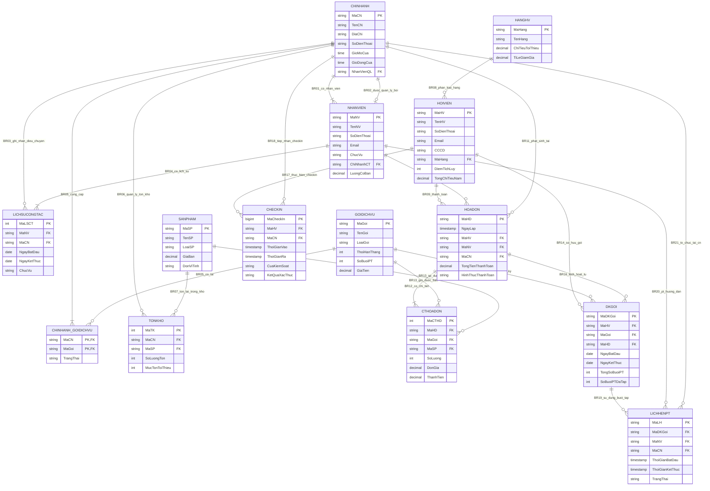

# TÀI LIỆU THIẾT KẾ MÔ HÌNH THỰC THỂ - MỐI KẾT HỢP (ENTITY - RELATIONSHIP)
## HỆ THỐNG QUẢN LÝ CHUỖI PHÒNG TẬP FITLIFE HUB

---

## 1. GIỚI THIỆU TỔNG QUAN

Tài liệu này xác định danh sách các **Thực thể (Entities)** và **Mối kết hợp (Relationships)** cho hệ thống chuỗi phòng tập thể hình và chăm sóc sức khỏe **FitLife Hub**, dựa trên tài liệu đặc tả nghiệp vụ [`MoTa.md`](file:///e:/EXERCISE-2-main/docs/MoTa.md) và hệ thống quy tắc ràng buộc [`BusinessRule.md`](file:///e:/EXERCISE-2-main/docs/BusinessRule.md).

Mô hình này đóng vai trò là nền tảng cho **Giai đoạn 1 (Thiết kế dữ liệu mức quan niệm & mức logic)**, đồng thời chuẩn bị cho các giải pháp tối ưu hóa hiệu năng cơ sở dữ liệu ở **Giai đoạn 2 (Mức vật lý)** để giải quyết 5 bài toán thực tế của hệ thống.

---

## 2. DANH SÁCH CÁC THỰC THỂ (ENTITIES)

Hệ thống bao gồm **14 thực thể** (bao gồm cả thực thể thông thường và thực thể kết hợp/thực thể yếu):

| STT | Tên Thực Thể | Tên Bảng (Quy ước CSDL) | Loại Thực Thể | Mô Tả Vai Trò |
| :---: | :--- | :--- | :--- | :--- |
| 1 | **ChiNhanh** | `branches` | Thực thể mạnh | Quản lý thông tin 12 chi nhánh phòng tập trên toàn quốc. |
| 2 | **NhanVien** | `employees` | Thực thể mạnh | Quản lý thông tin nhân sự (PT/HLV, Lễ tân, Quản lý, Bán hàng). |
| 3 | **LichSuCongTac** | `work_histories` | Thực thể phụ thuộc | Theo dõi quá trình điều chuyển công tác của nhân viên giữa các chi nhánh. |
| 4 | **HangHV** | `membership_tiers` | Thực thể mạnh (Danh mục) | Định nghĩa các phân hạng hội viên (Silver, Gold, Platinum) và quyền lợi. |
| 5 | **HoiVien** | `members` | Thực thể mạnh | Quản lý thông tin khách hàng/hội viên tập luyện tại hệ thống. |
| 6 | **GoiDichVu** | `service_packages` | Thực thể mạnh | Danh mục các gói tập/dịch vụ (Gym, Yoga, PT 1-1, Spa,...). |
| 7 | **ChiNhanh_GoiDichVu** | `branch_packages` | Thực thể kết hợp | Quản lý danh sách các gói dịch vụ được cung cấp tại từng chi nhánh (BR05). |
| 8 | **SanPham** | `products` | Thực thể mạnh | Danh mục sản phẩm bán lẻ (Whey protein, bình nước, thảm yoga,...). |
| 9 | **TonKho** | `branch_inventories` | Thực thể kết hợp | Quản lý số lượng tồn kho của từng sản phẩm tại từng chi nhánh (BR06, BR07). |
| 10 | **HoaDon** | `invoices` | Thực thể mạnh | Quản lý thông tin giao dịch thanh toán của hội viên tại chi nhánh. |
| 11 | **CTHoaDon** | `invoice_details` | Thực thể yếu | Chi tiết các mặt hàng (Gói dịch vụ hoặc Sản phẩm) trong mỗi hóa đơn. |
| 12 | **DKGoi** | `member_packages` | Thực thể kết hợp | Quản lý các gói tập mà hội viên đang sở hữu kích hoạt từ hóa đơn. |
| 13 | **CheckIn** | `check_in_logs` | Thực thể sự kiện (Event) | Ghi nhận nhật ký ra/vào phòng tập của hội viên qua cổng kiểm soát. |
| 14 | **LichHenPT** | `pt_appointments` | Thực thể sự kiện (Event) | Quản lý các buổi hẹn tập 1-1 giữa hội viên và huấn luyện viên cá nhân (PT). |

---

## 3. ĐẶC TẢ CHI TIẾT CÁC THỰC THỂ VÀ THUỘC TÍNH (ATTRIBUTES)

### 3.1. Thực thể `ChiNhanh` (Branch)
- **Mục đích**: Lưu trữ thông tin định danh và vận hành của từng cơ sở phòng tập.
- **Thuộc tính**:
  - `MaCN` (PK, VARCHAR(10)): Mã định danh chi nhánh (ví dụ: `CN01`, `CN02`,...).
  - `TenCN` (VARCHAR(100), NOT NULL): Tên chi nhánh (ví dụ: FitLife Hub Quận 1).
  - `DiaChi` (VARCHAR(255), NOT NULL): Địa chỉ chi tiết.
  - `SoDienThoai` (VARCHAR(15), NOT NULL, UNIQUE): Hotline chi nhánh.
  - `GioMoCua` (TIME, NOT NULL): Giờ bắt đầu hoạt động (ví dụ: `06:00:00`).
  - `GioDongCua` (TIME, NOT NULL): Giờ đóng cửa (ví dụ: `22:00:00`).
  - `NhanVienQL` (FK, VARCHAR(10), UNIQUE, NOT NULL): Mã nhân viên đang quản lý chi nhánh (tham chiếu `NhanVien(MaNV)` theo BR02).
  - `NgayKhaiTruong` (DATE): Ngày chi nhánh chính thức đi vào hoạt động.
  - `TrangThai` (VARCHAR(20), DEFAULT 'HOAT_DONG'): Trạng thái hoạt động (`HOAT_DONG`, `BAO_TRI`, `DONG_CUA`).

### 3.2. Thực thể `NhanVien` (Employee)
- **Mục đích**: Quản lý thông tin cá nhân, chức vụ và chi nhánh làm việc hiện tại của nhân sự.
- **Thuộc tính**:
  - `MaNV` (PK, VARCHAR(10)): Mã nhân viên (ví dụ: `NV001`).
  - `TenNV` (VARCHAR(100), NOT NULL): Họ và tên nhân viên.
  - `SoDienThoai` (VARCHAR(15), NOT NULL, UNIQUE): Số điện thoại liên lạc.
  - `Email` (VARCHAR(100), UNIQUE): Địa chỉ email.
  - `ChucVu` (VARCHAR(50), NOT NULL): Vai trò nhân viên (`QUAN_LY`, `LE_TAN`, `PT_HLV`, `BAN_HANG`).
  - `ChiNhanhCT` (FK, VARCHAR(10), NOT NULL): Chi nhánh đang làm việc hiện tại (tham chiếu `ChiNhanh(MaCN)` theo BR01).
  - `LuongCoBan` (DECIMAL(12, 2), NOT NULL): Mức lương cơ bản thỏa thuận.
  - `NgayVaoLam` (DATE, NOT NULL): Ngày gia nhập công ty.
  - `TrangThai` (VARCHAR(20), DEFAULT 'DANG_LAM_VIEC'): Trạng thái làm việc (`DANG_LAM_VIEC`, `NGHI_PHEP`, `DA_NGHI_VIEC`).

### 3.3. Thực thể `LichSuCongTac` (Work History)
- **Mục đích**: Theo dõi toàn bộ lịch sử điều chuyển chi nhánh và vị trí công tác của nhân viên theo thời gian (giải quyết Vấn đề 5 về tính lương/hoa hồng PT).
- **Thuộc tính**:
  - `MaLSCT` (PK, INT / SERIAL): Mã định danh bản ghi lịch sử.
  - `MaNV` (FK, VARCHAR(10), NOT NULL): Mã nhân viên được điều chuyển (tham chiếu `NhanVien(MaNV)` theo BR04).
  - `MaCN` (FK, VARCHAR(10), NOT NULL): Chi nhánh công tác trong giai đoạn đó (tham chiếu `ChiNhanh(MaCN)` theo BR03).
  - `NgayBatDau` (DATE, NOT NULL): Ngày bắt đầu làm việc tại chi nhánh.
  - `NgayKetThuc` (DATE, NULL): Ngày kết thúc công tác tại chi nhánh (`NULL` nếu đang là chi nhánh hiện tại).
  - `ChucVu` (VARCHAR(50), NOT NULL): Chức danh tại thời điểm công tác đó.
  - `GhiChu` (TEXT): Lý do điều chuyển hoặc quyết định bổ nhiệm.

### 3.4. Thực thể `HangHV` (Membership Tier)
- **Mục đích**: Định nghĩa các hạng thành viên thân thiết và ngưỡng tích lũy để phân hạng.
- **Thuộc tính**:
  - `MaHang` (PK, VARCHAR(10)): Mã hạng hội viên (`SILVER`, `GOLD`, `PLATINUM`).
  - `TenHang` (VARCHAR(50), NOT NULL, UNIQUE): Tên hiển thị của hạng.
  - `ChiTieuToiThieu` (DECIMAL(12, 2), NOT NULL): Mức chi tiêu tối thiểu trong 12 tháng qua để đạt hạng.
  - `TiLeGiamGia` (DECIMAL(5, 2), DEFAULT 0.00): Tỷ lệ chiết khấu giảm giá hóa đơn (%).
  - `MoTa` (TEXT): Quyền lợi đặc biệt đi kèm của hạng hội viên.

### 3.5. Thực thể `HoiVien` (Member / Customer)
- **Mục đích**: Quản lý hồ sơ cá nhân, hạng thành viên và điểm tích lũy của khách hàng.
- **Thuộc tính**:
  - `MaHV` (PK, VARCHAR(10)): Mã hội viên (ví dụ: `HV0001`).
  - `TenHV` (VARCHAR(100), NOT NULL): Họ và tên khách hàng.
  - `SoDienThoai` (VARCHAR(15), NOT NULL, UNIQUE): Số điện thoại dùng làm định danh đăng nhập / quét mã.
  - `Email` (VARCHAR(100), UNIQUE): Địa chỉ email nhận hóa đơn và thông báo.
  - `CCCD` (VARCHAR(20), UNIQUE): Căn cước công dân / Hộ chiếu.
  - `GioiTinh` (VARCHAR(10)): Giới tính (`NAM`, `NU`, `KHAC`).
  - `NgaySinh` (DATE): Ngày tháng năm sinh.
  - `NgayDangKy` (DATE, DEFAULT CURRENT_DATE): Ngày bắt đầu tham gia hệ thống.
  - `MaHang` (FK, VARCHAR(10), NOT NULL): Hạng thành viên hiện tại (tham chiếu `HangHV(MaHang)` theo BR08).
  - `DiemTichLuy` (INT, DEFAULT 0): Điểm thưởng Loyalty khả dụng (1 điểm = 100.000 VNĐ chi tiêu).
  - `TongChiTieuNam` (DECIMAL(12, 2), DEFAULT 0.00): Tổng chi tiêu trong 12 tháng gần nhất (dùng xét hạng định kỳ, giải quyết Vấn đề 4).
  - `TrangThai` (VARCHAR(20), DEFAULT 'HOAT_DONG'): Trạng thái (`HOAT_DONG`, `TAM_KHOA`, `DA_HUY`).

### 3.6. Thực thể `GoiDichVu` (Service Package)
- **Mục đích**: Danh mục các gói dịch vụ tập luyện và chăm sóc sức khỏe.
- **Thuộc tính**:
  - `MaGoi` (PK, VARCHAR(10)): Mã gói dịch vụ (ví dụ: `GYM3M`, `YOGA6M`, `PT10B`, `SPA01`).
  - `TenGoi` (VARCHAR(100), NOT NULL): Tên gói dịch vụ.
  - `LoaiGoi` (VARCHAR(50), NOT NULL): Loại hình (`GYM`, `YOGA`, `GROUP_X`, `PT_1_1`, `SPA_SAUNA`).
  - `ThoiHanThang` (INT, DEFAULT 0): Thời hạn hiệu lực tính theo tháng (1, 3, 6, 12 tháng; vé lẻ = 0).
  - `SoBuoiPT` (INT, DEFAULT 0): Số buổi huấn luyện viên cá nhân kèm (nếu là gói PT hoặc kèm PT).
  - `GiaTien` (DECIMAL(12, 2), NOT NULL): Giá niêm yết của gói dịch vụ.
  - `MoTa` (TEXT): Chi tiết quyền lợi và quy định sử dụng gói.
  - `TrangThai` (VARCHAR(20), DEFAULT 'DANG_KINH_DOANH'): Trạng thái (`DANG_KINH_DOANH`, `NGUNG_CUNG_CAP`).

### 3.7. Thực thể `ChiNhanh_GoiDichVu` (Branch - Package Availability)
- **Mục đích**: Thực thể kết hợp thể hiện mối quan hệ nhiều-nhiều giữa ChiNhanh và GoiDichVu (BR05).
- **Thuộc tính**:
  - `MaCN` (PK, FK, VARCHAR(10)): Mã chi nhánh cung cấp (tham chiếu `ChiNhanh(MaCN)`).
  - `MaGoi` (PK, FK, VARCHAR(10)): Mã gói dịch vụ được cung cấp (tham chiếu `GoiDichVu(MaGoi)`).
  - `NgayBatDauCungCap` (DATE, DEFAULT CURRENT_DATE): Ngày chi nhánh mở bán gói này.
  - `TrangThai` (VARCHAR(20), DEFAULT 'DANG_CUNG_CAP'): Tình trạng (`DANG_CUNG_CAP`, `TAM_NGUNG`).

### 3.8. Thực thể `SanPham` (Retail Product)
- **Mục đích**: Danh mục các sản phẩm phụ kiện thể thao, dinh dưỡng bổ sung bán lẻ tại quầy.
- **Thuộc tính**:
  - `MaSP` (PK, VARCHAR(10)): Mã sản phẩm (ví dụ: `SP001`, `WHEY01`,...).
  - `TenSP` (VARCHAR(100), NOT NULL): Tên sản phẩm.
  - `LoaiSP` (VARCHAR(50), NOT NULL): Phân loại (`THUC_PHAM_BO_SUNG`, `PHU_KIEN`, `NUOC_GIAI_KHAT`, `DUNG_CU`).
  - `GiaBan` (DECIMAL(12, 2), NOT NULL): Giá bán lẻ niêm yết.
  - `DonViTinh` (VARCHAR(20), NOT NULL): Đơn vị tính (Hộp, Chai, Cái, Bộ,...).
  - `MoTa` (TEXT): Mô tả xuất xứ, quy cách sản phẩm.
  - `TrangThai` (VARCHAR(20), DEFAULT 'DANG_BAN'): Trạng thái (`DANG_BAN`, `NGUNG_KINH_DOANH`).

### 3.9. Thực thể `TonKho` (Branch Inventory)
- **Mục đích**: Quản lý số lượng hàng tồn kho của từng sản phẩm tại từng cơ sở chi nhánh cụ thể (BR06, BR07).
- **Thuộc tính**:
  - `MaTK` (PK, INT / SERIAL): Mã định danh bản ghi tồn kho.
  - `MaCN` (FK, VARCHAR(10), NOT NULL): Mã chi nhánh lưu kho (tham chiếu `ChiNhanh(MaCN)`).
  - `MaSP` (FK, VARCHAR(10), NOT NULL): Mã sản phẩm trong kho (tham chiếu `SanPham(MaSP)`).
  - `SoLuongTon` (INT, NOT NULL, DEFAULT 0, CHECK >= 0): Số lượng hiện có tại kho chi nhánh.
  - `MucTonToiThieu` (INT, DEFAULT 5): Mức tồn tối thiểu để phát cảnh báo nhập thêm hàng.
  - `NgayCapNhatCuoi` (TIMESTAMP, DEFAULT CURRENT_TIMESTAMP): Thời điểm cập nhật số lượng gần nhất.
  - *Ràng buộc duy nhất*: `UNIQUE(MaCN, MaSP)`.

### 3.10. Thực thể `HoaDon` (Invoice)
- **Mục đích**: Ghi nhận toàn bộ thông tin tài chính của giao dịch bán gói dịch vụ và sản phẩm.
- **Thuộc tính**:
  - `MaHD` (PK, VARCHAR(15)): Mã hóa đơn (ví dụ: `HD202610230001`).
  - `NgayLap` (TIMESTAMP, DEFAULT CURRENT_TIMESTAMP): Thời điểm lập hóa đơn.
  - `MaHV` (FK, VARCHAR(10), NOT NULL): Khách hàng thanh toán (tham chiếu `HoiVien(MaHV)` theo BR09).
  - `MaNV` (FK, VARCHAR(10), NOT NULL): Nhân viên lập hóa đơn (tham chiếu `NhanVien(MaNV)` theo BR10).
  - `MaCN` (FK, VARCHAR(10), NOT NULL): Chi nhánh phát sinh giao dịch (tham chiếu `ChiNhanh(MaCN)` theo BR11).
  - `TongTienGoc` (DECIMAL(12, 2), NOT NULL): Tổng tiền hàng trước khi áp dụng chiết khấu.
  - `SoTienGiam` (DECIMAL(12, 2), DEFAULT 0.00): Số tiền được giảm giá theo hạng hội viên hoặc khuyến mãi.
  - `TongTienThanhToan` (DECIMAL(12, 2), NOT NULL): Số tiền thực tế hội viên phải trả (`TongTienGoc - SoTienGiam`).
  - `DiemSuDung` (INT, DEFAULT 0): Số điểm Loyalty đã cấn trừ trong lần thanh toán này.
  - `DiemTichLuyMoi` (INT, DEFAULT 0): Số điểm thưởng được cộng thêm từ hóa đơn này.
  - `HinhThucThanhToan` (VARCHAR(30), NOT NULL): Phương thức (`TIEN_MAT`, `VNPAY`, `THE_ATM_VISA`, `CHUYEN_KHOAN`).
  - `TrangThai` (VARCHAR(20), DEFAULT 'DA_THANH_TOAN'): Trạng thái (`CHO_THANH_TOAN`, `DA_THANH_TOAN`, `DA_HUY`).

### 3.11. Thực thể `CTHoaDon` (Invoice Detail)
- **Mục đích**: Lưu chi tiết từng dòng mặt hàng trong hóa đơn (mua gói tập hoặc mua sản phẩm bán lẻ) theo BR12 và BR13.
- **Thuộc tính**:
  - `MaCTHD` (PK, INT / SERIAL): Mã định danh chi tiết hóa đơn.
  - `MaHD` (FK, VARCHAR(15), NOT NULL): Hóa đơn chứa dòng này (tham chiếu `HoaDon(MaHD)`).
  - `MaGoi` (FK, VARCHAR(10), NULL): Tham chiếu `GoiDichVu(MaGoi)` nếu mặt hàng là gói dịch vụ.
  - `MaSP` (FK, VARCHAR(10), NULL): Tham chiếu `SanPham(MaSP)` nếu mặt hàng là sản phẩm bán lẻ.
  - `LoaiHang` (VARCHAR(20), NOT NULL): Phân loại (`GOI_DICH_VU`, `SAN_PHAM`).
  - `SoLuong` (INT, NOT NULL, CHECK > 0): Số lượng mua.
  - `DonGia` (DECIMAL(12, 2), NOT NULL): Đơn giá tại thời điểm xuất hóa đơn.
  - `ThanhTien` (DECIMAL(12, 2), NOT NULL): Thành tiền (`SoLuong * DonGia`).
  - *Ràng buộc toàn vẹn*: Phải có đúng một trong hai trường `MaGoi` hoặc `MaSP` khác NULL (BR13).

### 3.12. Thực thể `DKGoi` (Member Package Subscription)
- **Mục đích**: Quản lý gói tập/dịch vụ cụ thể mà hội viên sở hữu sau khi kích hoạt từ hóa đơn thanh toán (BR14, BR15, BR16).
- **Thuộc tính**:
  - `MaDKGoi` (PK, VARCHAR(15)): Mã đăng ký gói (ví dụ: `DKG202600001`).
  - `MaHV` (FK, VARCHAR(10), NOT NULL): Hội viên sở hữu (tham chiếu `HoiVien(MaHV)`).
  - `MaGoi` (FK, VARCHAR(10), NOT NULL): Gói dịch vụ đã mua (tham chiếu `GoiDichVu(MaGoi)`).
  - `MaHD` (FK, VARCHAR(15), NOT NULL): Hóa đơn kích hoạt gói này (tham chiếu `HoaDon(MaHD)`).
  - `NgayBatDau` (DATE, NOT NULL): Ngày gói bắt đầu có hiệu lực.
  - `NgayKetThuc` (DATE, NOT NULL): Ngày hết hạn gói.
  - `TongSoBuoiPT` (INT, DEFAULT 0): Tổng số buổi PT được hưởng theo gói.
  - `SoBuoiPTDaTap` (INT, DEFAULT 0): Số buổi PT đã hoàn thành.
  - `SoBuoiPTConLai` (INT, GENERATED ALWAYS AS (TongSoBuoiPT - SoBuoiPTDaTap)): Số buổi PT còn lại khả dụng.
  - `TrangThai` (VARCHAR(20), DEFAULT 'DANG_HOAT_DONG'): Trạng thái (`DANG_HOAT_DONG`, `HET_HAN`, `BAO_LUU`, `DA_HUY`).

### 3.13. Thực thể `CheckIn` (Check-in Access Log)
- **Mục đích**: Ghi nhận toàn bộ sự kiện ra/vào cổng của hội viên tại các chi nhánh (giải quyết Vấn đề 1 & Vấn đề 3: nghẽn check-in và bảng log bùng nổ dữ liệu).
- **Thuộc tính**:
  - `MaCheckIn` (PK, BIGINT / BIGSERIAL): Mã lượt check-in tự tăng (sử dụng BIGINT cho khối lượng log lớn).
  - `MaHV` (FK, VARCHAR(10), NOT NULL): Hội viên thực hiện quét mã (tham chiếu `HoiVien(MaHV)` theo BR17).
  - `MaCN` (FK, VARCHAR(10), NOT NULL): Chi nhánh nơi diễn ra lượt check-in (tham chiếu `ChiNhanh(MaCN)` theo BR18).
  - `ThoiGianVao` (TIMESTAMP, NOT NULL, DEFAULT CURRENT_TIMESTAMP): Thời điểm quẹt thẻ/QR vào phòng tập.
  - `ThoiGianRa` (TIMESTAMP, NULL): Thời điểm quẹt ra về (`NULL` nếu đang trong phòng tập).
  - `CuaKiemSoat` (VARCHAR(50), NOT NULL): Mã thiết bị / cổng quay (Turnstile Gate 01, Turnstile Gate 02,...).
  - `KetQuaXacThuc` (VARCHAR(20), NOT NULL): Kết quả xử lý (`HOP_LE`, `GOI_HET_HAN`, `SAI_CHI_NHANH`, `KHONG_TON_TAI`).
  - `GhiChu` (VARCHAR(255), NULL): Ghi chú lỗi xác thực (nếu có).

### 3.14. Thực thể `LichHenPT` (PT Appointment)
- **Mục đích**: Quản lý lịch hẹn tập luyện 1-1 giữa hội viên và huấn luyện viên cá nhân (giải quyết Vấn đề 2 về xung đột đặt lịch đồng thời / Overbooking).
- **Thuộc tính**:
  - `MaLH` (PK, VARCHAR(15)): Mã lịch hẹn (ví dụ: `LH20261023001`).
  - `MaDKGoi` (FK, VARCHAR(15), NOT NULL): Mã gói PT mà hội viên sử dụng để trừ buổi (tham chiếu `DKGoi(MaDKGoi)` theo BR19).
  - `MaNV` (FK, VARCHAR(10), NOT NULL): Huấn luyện viên (PT) phụ trách hướng dẫn (tham chiếu `NhanVien(MaNV)` theo BR20).
  - `MaCN` (FK, VARCHAR(10), NOT NULL): Chi nhánh diễn ra buổi tập (tham chiếu `ChiNhanh(MaCN)` theo BR21).
  - `ThoiGianBatDau` (TIMESTAMP, NOT NULL): Thời gian bắt đầu buổi tập (ví dụ: `2026-10-23 18:00:00`).
  - `ThoiGianKetThuc` (TIMESTAMP, NOT NULL): Thời gian kết thúc buổi tập (ví dụ: `2026-10-23 19:00:00`).
  - `TrangThai` (VARCHAR(20), DEFAULT 'DA_DAT'): Trạng thái lịch (`DA_DAT`, `HOAN_THANH`, `DA_HUY`, `VANG_MAT`).
  - `DanhGiaSao` (INT, CHECK (DanhGiaSao BETWEEN 1 AND 5)): Đánh giá chất lượng của hội viên cho PT.
  - `NhanXetHoiVien` (TEXT): Ý kiến phản hồi của hội viên sau buổi tập.

---

## 4. DANH SÁCH MỐI KẾT HỢP VÀ ÁNH XẠ BUSINESS RULES (RELATIONSHIPS)

Bảng tổng hợp chi tiết **21 mối kết hợp nghiệp vụ** từ `BR01` đến `BR21` cùng bản số (Cardinality min, max) theo cả hai chiều:

| Mã BR | Tên Mối Kết Hợp | Thực Thể A | Bản Số (A $\rightarrow$ B) | Thực Thể B | Bản Số (B $\rightarrow$ A) | Loại Quan Hệ | Ý Nghĩa Nghiệp Vụ & Cơ Chế Khóa Ngoại |
| :---: | :--- | :---: | :---: | :---: | :---: | :---: | :--- |
| **BR01** | LamViecTai | `ChiNhanh` | (1, N) | `NhanVien` | (1, 1) | **1 : N** | Một chi nhánh có ít nhất 1 và tối đa nhiều nhân viên đang làm việc. Một nhân viên tại một thời điểm chỉ trực thuộc đúng 1 chi nhánh. Khóa ngoại `NhanVien.ChiNhanhCT -> ChiNhanh.MaCN`. |
| **BR02** | DuocQuanLyBoi | `ChiNhanh` | (1, 1) | `NhanVien` | (0, 1) | **1 : 1** | Mỗi chi nhánh chỉ được điều hành bởi đúng 1 Quản lý chi nhánh. Một nhân viên có thể không quản lý hoặc quản lý tối đa 1 chi nhánh. Khóa ngoại `ChiNhanh.NhanVienQL -> NhanVien.MaNV` (Unique). |
| **BR03** | GhiNhanDieuChuyen | `ChiNhanh` | (0, N) | `LichSuCongTac`| (1, 1) | **1 : N** | Một chi nhánh có thể xuất hiện trong nhiều bản ghi điều chuyển công tác. Một bản ghi công tác chỉ ghi nhận cho đúng 1 chi nhánh. Khóa ngoại `LichSuCongTac.MaCN -> ChiNhanh.MaCN`. |
| **BR04** | CoLichSuCongTac | `NhanVien` | (1, N) | `LichSuCongTac`| (1, 1) | **1 : N** | Mỗi nhân viên khi vào làm ít nhất có 1 bản ghi công tác (chi nhánh đầu tiên) và tối đa N bản ghi khi chuyển chi nhánh. Khóa ngoại `LichSuCongTac.MaNV -> NhanVien.MaNV`. |
| **BR05** | CungCapGoiDichVu | `ChiNhanh` | (1, N) | `GoiDichVu` | (0, N) | **N : N** | Một chi nhánh cung cấp 1 hoặc nhiều gói dịch vụ. Một gói dịch vụ có thể được mở bán tại 0 hoặc nhiều chi nhánh. Được tách thành bảng kết hợp `ChiNhanh_GoiDichVu(MaCN, MaGoi)`. |
| **BR06** | QuanLyTonKho | `ChiNhanh` | (0, N) | `TonKho` | (1, 1) | **1 : N** | Một chi nhánh có thể quản lý nhiều bản ghi tồn kho các sản phẩm. Một bản ghi tồn kho chỉ thuộc về duy nhất 1 chi nhánh. Khóa ngoại `TonKho.MaCN -> ChiNhanh.MaCN`. |
| **BR07** | LuuTruTrongKho | `SanPham` | (0, N) | `TonKho` | (1, 1) | **1 : N** | Một sản phẩm có thể có tồn kho ở nhiều chi nhánh khác nhau. Một dòng tồn kho chỉ đại diện cho đúng 1 sản phẩm. Khóa ngoại `TonKho.MaSP -> SanPham.MaSP`. |
| **BR08** | ThuocPhanHang | `HangHV` | (0, N) | `HoiVien` | (1, 1) | **1 : N** | Một hạng hội viên có thể có nhiều hội viên đạt chuẩn. Mỗi hội viên tại một thời điểm chỉ thuộc về duy nhất 1 hạng thành viên. Khóa ngoại `HoiVien.MaHang -> HangHV.MaHang`. |
| **BR09** | ThanhToanHoaDon | `HoiVien` | (0, N) | `HoaDon` | (1, 1) | **1 : N** | Một hội viên có thể thanh toán nhiều hóa đơn. Mỗi hóa đơn chỉ được lập cho duy nhất 1 hội viên xác định. Khóa ngoại `HoaDon.MaHV -> HoiVien.MaHV`. |
| **BR10** | LapHoaDon | `NhanVien` | (0, N) | `HoaDon` | (1, 1) | **1 : N** | Một nhân viên thu ngân/lễ tân có thể xuất nhiều hóa đơn. Mỗi hóa đơn do đúng 1 nhân viên lập. Khóa ngoại `HoaDon.MaNV -> NhanVien.MaNV`. |
| **BR11** | PhatSinhHoaDon | `ChiNhanh` | (0, N) | `HoaDon` | (1, 1) | **1 : N** | Một chi nhánh có thể phát sinh nhiều hóa đơn bán hàng. Mỗi hóa đơn được lập tại đúng 1 cơ sở chi nhánh. Khóa ngoại `HoaDon.MaCN -> ChiNhanh.MaCN`. |
| **BR12** | CoChiTietHoaDon | `HoaDon` | (1, N) | `CTHoaDon` | (1, 1) | **1 : N** | Một hóa đơn hợp lệ phải có ít nhất 1 dòng chi tiết mặt hàng và tối đa N dòng. Mỗi dòng chi tiết chỉ thuộc 1 hóa đơn. Khóa ngoại `CTHoaDon.MaHD -> HoaDon.MaHD`. |
| **BR13** | ChuaMatHang | `GoiDichVu` / `SanPham` | (0, N) | `CTHoaDon` | (0, 1) | **1 : N (Tùy chọn)** | Mỗi dòng CTHoaDon tham chiếu đến (0, 1) GoiDichVu và (0, 1) SanPham (đúng một trong hai không null). Một gói dịch vụ/sản phẩm có thể nằm trong nhiều chi tiết hóa đơn. |
| **BR14** | SoHuuDKGoi | `HoiVien` | (0, N) | `DKGoi` | (1, 1) | **1 : N** | Một hội viên có thể mua và sở hữu nhiều gói dịch vụ cùng lúc. Mỗi gói kích hoạt thuộc quyền sở hữu của đúng 1 hội viên. Khóa ngoại `DKGoi.MaHV -> HoiVien.MaHV`. |
| **BR15** | DangKyTheoGoi | `GoiDichVu` | (0, N) | `DKGoi` | (1, 1) | **1 : N** | Một gói dịch vụ có thể được đăng ký bởi nhiều hội viên. Mỗi bản ghi DKGoi là hiện thực hóa của đúng 1 gói dịch vụ cụ thể. Khóa ngoại `DKGoi.MaGoi -> GoiDichVu.MaGoi`. |
| **BR16** | KichHoatTuHoaDon | `HoaDon` | (0, N) | `DKGoi` | (1, 1) | **1 : N** | Một hóa đơn có thể kích hoạt nhiều gói tập (nếu mua combo gói). Mỗi gói tập kích hoạt phải có chứng từ gốc từ đúng 1 hóa đơn. Khóa ngoại `DKGoi.MaHD -> HoaDon.MaHD`. |
| **BR17** | ThucHienCheckIn | `HoiVien` | (0, N) | `CheckIn` | (1, 1) | **1 : N** | Một hội viên có thể có nhiều lượt check-in qua cổng trong suốt quá trình tập. Mỗi lượt check-in gắn với đúng 1 hội viên quẹt thẻ/QR. Khóa ngoại `CheckIn.MaHV -> HoiVien.MaHV`. |
| **BR18** | TiepNhanCheckIn | `ChiNhanh` | (0, N) | `CheckIn` | (1, 1) | **1 : N** | Một chi nhánh tiếp nhận hàng ngàn lượt check-in mỗi ngày. Mỗi lượt check-in chỉ diễn ra tại cửa quay của đúng 1 chi nhánh. Khóa ngoại `CheckIn.MaCN -> ChiNhanh.MaCN`. |
| **BR19** | DuaTrenDKGoi | `DKGoi` | (0, N) | `LichHenPT` | (1, 1) | **1 : N** | Một gói PT có thể đặt nhiều buổi tập khác nhau cho đến khi hết số buổi. Mỗi buổi hẹn PT phải được khấu trừ từ đúng 1 gói PT hợp lệ. Khóa ngoại `LichHenPT.MaDKGoi -> DKGoi.MaDKGoi`. |
| **BR20** | HuongDanBoiPT | `NhanVien` | (0, N) | `LichHenPT` | (1, 1) | **1 : N** | Một huấn luyện viên cá nhân có thể hướng dẫn nhiều buổi hẹn tập khác nhau. Mỗi buổi tập 1-1 do đúng 1 huấn luyện viên phụ trách. Khóa ngoại `LichHenPT.MaNV -> NhanVien.MaNV`. |
| **BR21** | ToChucTaiChiNhanh| `ChiNhanh` | (0, N) | `LichHenPT` | (1, 1) | **1 : N** | Một chi nhánh có thể tổ chức nhiều buổi tập PT. Mỗi buổi tập PT diễn ra tại đúng 1 cơ sở chi nhánh. Khóa ngoại `LichHenPT.MaCN -> ChiNhanh.MaCN`. |

---

## 5. MA TRẬN QUAN HỆ GIỮA CÁC THỰC THỂ (RELATIONSHIP MATRIX)

Ma trận dưới đây thể hiện mối tương quan trực tiếp giữa các thực thể trong hệ thống FitLife Hub:

| Thực Thể | ChiNhanh | NhanVien | LichSuCongTac | HangHV | HoiVien | GoiDichVu | ChiNhanh_GoiDichVu | SanPham | TonKho | HoaDon | CTHoaDon | DKGoi | CheckIn | LichHenPT |
| :--- | :---: | :---: | :---: | :---: | :---: | :---: | :---: | :---: | :---: | :---: | :---: | :---: | :---: | :---: |
| **ChiNhanh** | - | 1:N (BR01) / 1:1 (BR02) | 1:N (BR03) | - | - | N:N (BR05) | 1:N | - | 1:N (BR06) | 1:N (BR11) | - | - | 1:N (BR18) | 1:N (BR21) |
| **NhanVien** | 1:1 (BR01) / 0:1 (BR02) | - | 1:N (BR04) | - | - | - | - | - | - | 1:N (BR10) | - | - | - | 1:N (BR20) |
| **LichSuCongTac**| N:1 (BR03) | N:1 (BR04) | - | - | - | - | - | - | - | - | - | - | - | - |
| **HangHV** | - | - | - | - | 1:N (BR08) | - | - | - | - | - | - | - | - | - |
| **HoiVien** | - | - | - | N:1 (BR08) | - | - | - | - | - | 1:N (BR09) | - | 1:N (BR14) | 1:N (BR17) | - |
| **GoiDichVu** | N:N (BR05) | - | - | - | - | - | 1:N | - | - | - | 1:N (BR13) | 1:N (BR15) | - | - |
| **ChiNhanh_GoiDichVu** | N:1 | - | - | - | - | N:1 | - | - | - | - | - | - | - | - |
| **SanPham** | - | - | - | - | - | - | - | - | 1:N (BR07) | - | 1:N (BR13) | - | - | - |
| **TonKho** | N:1 (BR06) | - | - | - | - | - | - | N:1 (BR07) | - | - | - | - | - | - |
| **HoaDon** | N:1 (BR11) | N:1 (BR10) | - | - | N:1 (BR09) | - | - | - | - | - | 1:N (BR12) | 1:N (BR16) | - | - |
| **CTHoaDon** | - | - | - | - | - | N:0..1 (BR13) | - | N:0..1 (BR13) | - | N:1 (BR12) | - | - | - | - |
| **DKGoi** | - | - | - | - | N:1 (BR14) | N:1 (BR15) | - | - | - | N:1 (BR16) | - | - | - | 1:N (BR19) |
| **CheckIn** | N:1 (BR18) | - | - | - | N:1 (BR17) | - | - | - | - | - | - | - | - | - |
| **LichHenPT** | N:1 (BR21) | N:1 (BR20) | - | - | - | - | - | - | - | - | - | N:1 (BR19) | - | - |

---

## 6. SƠ ĐỒ THỰC THỂ - MỐI KẾT HỢP (ERD DIAGRAM)

Dưới đây là sơ đồ Mermaid ERD chuẩn hóa thể hiện toàn diện 14 thực thể và 21 quy tắc quan hệ:



---

## 7. ĐỊNH HƯỚNG GIẢI QUYẾT 5 VẤN ĐỀ THỰC TẾ DỰA TRÊN THIẾT KẾ ER

Mô hình thực thể trên được thiết kế tối ưu có chủ đích nhằm giải quyết triệt để 5 bài toán thực tế nêu tại mục **Vấn đề hệ thống thực tế** trong [`MoTa.md`](file:///e:/EXERCISE-2-main/docs/MoTa.md):

### 1. Nghẽn Check-in giờ cao điểm (Truy vấn xác thực < 50ms)
- **Thiết kế**: Tách biệt rõ thực thể `DKGoi` (chứa ngày hết hạn và trạng thái hiệu lực) và `CheckIn` (chỉ ghi log ra vào).
- **Giải pháp**:
  - Đánh chỉ mục hỗn hợp (Composite Index) trên `DKGoi(MaHV, TrangThai, NgayKetThuc)` giúp xác thực quyền vào cổng chỉ qua 1 lần quét index (Index-Only Scan).
  - Sử dụng khóa chính kiểu `BIGINT` cho `CheckIn` để ghi log tốc độ cao, hỗ trợ phân vùng (Partitioning) theo ngày/tháng để việc INSERT không bị lock bảng chính.

### 2. Xung đột đặt lịch HLV cá nhân (Ngăn chặn Overbooking tuyệt đối)
- **Thiết kế**: Thực thể `LichHenPT` lưu rõ `MaNV`, `ThoiGianBatDau`, `ThoiGianKetThuc` và `TrangThai`.
- **Giải pháp**:
  - Áp dụng ràng buộc loại trừ thời gian (PostgreSQL Exclusion Constraint: `EXCLUDE USING gist (MaNV WITH =, tsrange(ThoiGianBatDau, ThoiGianKetThuc) WITH &&) WHERE (TrangThai = 'DA_DAT')`).
  - Đảm bảo cơ chế kiểm tra đồng thời ở mức Database Engine, loại bỏ hoàn toàn khả năng trùng lịch giữa hai giao dịch đồng thời.

### 3. Bùng nổ dữ liệu Log & Báo cáo doanh thu chậm
- **Thiết kế**: Tách bạch luồng dữ liệu giao dịch hóa đơn (`HoaDon`, `CTHoaDon`) và luồng nhật ký vận hành (`CheckIn`).
- **Giải pháp**:
  - Áp dụng phân vùng bảng (Table Partitioning by Range) cho bảng `CheckIn` theo tháng (`PARTITION BY RANGE (ThoiGianVao)`).
  - Tạo bảng tổng hợp hoặc Materialized View định kỳ (Summary Tables) tổng hợp số lượt check-in và doanh thu theo ngày/chi nhánh để báo cáo cấp quản lý chạy trong < 1 giây.

### 4. Chi phí tính toán lại hạng hội viên bị quá tải
- **Thiết kế**: Lưu trữ trường `TongChiTieuNam` và `DiemTichLuy` ngay tại thực thể `HoiVien`, tham chiếu trực tiếp sang `HangHV`.
- **Giải pháp**:
  - Không tính toán lại toàn bộ lịch sử 12 tháng tại thời điểm thanh toán hóa đơn.
  - Sử dụng cơ chế cộng dồn gia tăng (Incremental Update) qua Trigger sau khi thanh toán hóa đơn thành công, kết hợp với Job định kỳ chạy ban đêm để rà soát hạ hạng nếu quá 12 tháng. Thao tác thanh toán và in hóa đơn phản hồi tức thì.

### 5. Tra cứu Lịch sử điều chuyển Nhân sự & Lương/Hoa hồng sai lệch
- **Thiết kế**: Thực thể `LichSuCongTac` lưu giữ khoảng thời gian `[NgayBatDau, NgayKetThuc]` tại từng chi nhánh của từng nhân viên. Thực thể `LichHenPT` lưu vết cả `MaNV`, `MaCN` và `ThoiGianBatDau`.
- **Giải pháp**:
  - Khi tính hoa hồng PT theo chi nhánh, liên kết `LichHenPT` với `LichSuCongTac` bằng điều kiện:
    ```sql
    ON LichHenPT.MaNV = LichSuCongTac.MaNV
    AND LichHenPT.ThoiGianBatDau >= LichSuCongTac.NgayBatDau
    AND (LichSuCongTac.NgayKetThuc IS NULL OR LichHenPT.ThoiGianBatDau <= LichSuCongTac.NgayKetThuc)
    ```
  - Đảm bảo xác định chính xác 100% thời điểm diễn ra buổi tập đó, PT đang thuộc biên chế chi nhánh nào, không bao giờ bị sai lệch hoa hồng khi chuyển chi nhánh.

---

## 8. KẾT LUẬN

Tài liệu này đã bao phủ toàn diện:
1. **14 thực thể** phản ánh đầy đủ nghiệp vụ chuỗi phòng tập FitLife Hub.
2. **21 quy tắc nghiệp vụ (BR01 - BR21)** được thể hiện chính xác qua bản số (min, max) và cơ chế khóa ngoại.
3. Sơ đồ **Mermaid ERD** trực quan, chuẩn xác.
4. Cơ sở vững chắc để triển khai **Giai đoạn 1 (Chuyển đổi sang mô hình dữ liệu quan hệ)** và **Giai đoạn 2 (Thiết kế vật lý, Indexing, Partitioning)** trong các bước tiếp theo của đồ án.
