# SƠ ĐỒ THỰC THỂ - MỐI KẾT HỢP (MERMAID ERD) - PHƯƠNG ÁN CHỐT

Dưới đây là sơ đồ Mermaid ERD chuẩn hóa phản ánh đầy đủ mô hình dữ liệu tối ưu cho **FitLife Hub** sau khi tiếp thu các phân tích phản biện kiến trúc:

```mermaid
erDiagram
    CHINHANH ||--|{ THIETBICONG : "co_thiet_bi"
    CHINHANH ||--|{ CHINHANH_DICHVU : "cung_cap"
    DICHVU ||--|{ CHINHANH_DICHVU : "co_tai"
    
    HANGHOIVIEN ||--o{ HOIVIEN : "xep_hang"
    HOIVIEN ||--o{ HV_CHITIEUTHANG : "tich_luy_thang"
    
    CHINHANH ||--o{ HOIVIEN : "dang_ky_ban_dau"
    HOIVIEN ||--o{ DKGOI : "so_huu"
    GOIDICHVU ||--o{ DKGOI : "duoc_mua"
    GOIDICHVU ||--|{ GOI_DICHVUAPDUNG : "gom_quyen_loi"
    DICHVU ||--|{ GOI_DICHVUAPDUNG : "thuoc_goi"
    
    HOIVIEN ||--o{ CHECKIN : "quet_the"
    CHINHANH ||--o{ CHECKIN : "tiep_nhan_checkin"
    THIETBICONG ||--o{ CHECKIN : "ghi_nhan_tai"
    
    DKGOI ||--o{ LICHHENPT : "tru_buoi_tap"
    NHANVIEN ||--o{ LICHHENPT : "huong_dan"
    CHINHANH ||--o{ LICHHENPT : "to_chuc_tai"
    KHUNGGIOPT ||--o{ LICHHENPT : "thuoc_slot"
    
    NHANVIEN ||--o{ LICHLAMVIECHLV : "dang_ky_ca"
    CHINHANH ||--o{ LICHLAMVIECHLV : "ca_truc_tai"
    
    CHINHANH ||--o{ TONKHO : "quan_ly_kho"
    SANPHAM ||--o{ TONKHO : "ton_trong_kho"
    TONKHO ||--o{ GIAODICHKHO : "nhat_ky_kho"
    
    CHINHANH ||--o{ HOADON : "phat_sinh_tai"
    NHANVIEN ||--o{ HOADON : "lap_hoa_don"
    HOIVIEN ||--o{ HOADON : "thanh_toan"
    HOADON ||--|{ CTHOADON : "gom_chi_tiet"
    HOADON ||--|{ THANHTOAN : "cac_lan_tra"
    
    GOIDICHVU ||--o{ CTHOADON : "dong_goi"
    SANPHAM ||--o{ CTHOADON : "dong_sp"
    
    CHINHANH ||--o{ NHANVIEN : "chi_nhanh_hien_tai"
    NHANVIEN ||--|{ LICHSUCONGTAC : "co_lich_su"
    CHINHANH ||--o{ LICHSUCONGTAC : "tai_chi_nhanh"
    NHANVIEN ||--o{ BANGHOAHONGPT : "huong_hoa_hong"
    CHINHANH ||--o{ BANGHOAHONGPT : "chi_tra_tai"

    CHINHANH {
        string MaCN PK
        string TenCN
        string DiaChi
        string ThanhPho
        string SoDienThoai
        time GioMoCua
        time GioDongCua
        int SucChuaToiDa
        string TrangThai
    }

    THIETBICONG {
        string MaThietBi PK
        string MaCN FK
        string TenThietBi
        string LoaiThietBi
        string TrangThai
    }

    DICHVU {
        string MaDV PK
        string TenDV
        string NhomDV
        string MoTa
    }

    CHINHANH_DICHVU {
        string MaCN PK, FK
        string MaDV PK, FK
        string TrangThai
    }

    HANGHOIVIEN {
        string MaHang PK
        string TenHang
        decimal NguongChiTieu12T
        decimal TiLeGiamGia
        smallint ThuTuHang
    }

    HOIVIEN {
        string MaHV PK
        string HoTen
        string SoDienThoai
        string Email
        string CCCD
        string GioiTinh
        date NgaySinh
        date NgayDangKy
        string MaCNDangKy FK
        string MaQR
        string MaHang FK
        int DiemTichLuy
        decimal TongChiTieu12T
        string TrangThai
    }

    HV_CHITIEUTHANG {
        string MaHV PK, FK
        date ThangNam PK
        decimal TongChiTieu
        int SoHoaDon
    }

    GOIDICHVU {
        string MaGoi PK
        string TenGoi
        string LoaiGoi
        smallint ThoiHanThang
        smallint SoBuoiPT
        decimal GiaNiemYet
        string PhamViSuDung
        string TrangThai
    }

    GOI_DICHVUAPDUNG {
        string MaGoi PK, FK
        string MaDV PK, FK
    }

    DKGOI {
        bigint MaDK PK
        string MaHV FK
        string MaGoi FK
        string MaHD
        string MaCNMua FK
        date NgayBatDau
        date NgayHetHan
        smallint TongBuoiPT
        smallint SoBuoiPTConLai
        string TrangThai
    }

    CHECKIN {
        bigint MaCheckIn PK
        timestamp ThoiGian PK
        string MaHV FK
        string MaCN FK
        string MaThietBi FK
        bigint MaDK FK
        string LoaiSuKien
        string KetQua
        string LyDoTuChoi
    }

    KHUNGGIOPT {
        smallint MaKhungGio PK
        time GioBatDau
        time GioKetThuc
    }

    LICHLAMVIECHLV {
        bigint MaLichLV PK
        string MaHLV FK
        string MaCN FK
        date NgayLam
        time GioBatDau
        time GioKetThuc
    }

    LICHHENPT {
        bigint MaLich PK
        string MaHV FK
        string MaHLV FK
        string MaCN FK
        bigint MaDK FK
        date NgayTap
        smallint MaKhungGio FK
        string TrangThai
        timestamp ThoiGianDat
        smallint DiemDanhGia
        string NhanXet
    }

    SANPHAM {
        string MaSP PK
        string TenSP
        string LoaiSP
        decimal GiaBan
        string DonViTinh
        string TrangThai
    }

    TONKHO {
        string MaCN PK, FK
        string MaSP PK, FK
        int SoLuongTon
        int MucTonToiThieu
        timestamp NgayCapNhat
    }

    GIAODICHKHO {
        bigint MaGDKho PK
        string MaCN FK
        string MaSP FK
        string LoaiGD
        int SoLuong
        string MaHD
        timestamp ThoiGian
        string MaNVThucHien FK
    }

    HOADON {
        string MaHD PK
        timestamp NgayLap
        string MaCN FK
        string MaNVLap FK
        string MaHV FK
        decimal TongTienHang
        decimal GiamGia
        decimal TongThanhToan
        int DiemTichLuy
        string TrangThai
    }

    CTHOADON {
        bigint MaCTHD PK
        string MaHD FK
        string LoaiHang
        string MaGoi FK
        string MaSP FK
        int SoLuong
        decimal DonGia
        decimal ThanhTien
    }

    THANHTOAN {
        bigint MaTT PK
        string MaHD FK
        string HinhThuc
        decimal SoTien
        string MaGiaoDichNgoai
        timestamp ThoiGian
    }

    NHANVIEN {
        string MaNV PK
        string HoTen
        string SoDienThoai
        string Email
        string ChucVu
        string MaCNHienTai FK
        decimal LuongCoBan
        date NgayVaoLam
        string TrangThai
    }

    LICHSUCONGTAC {
        bigint MaLSCT PK
        string MaNV FK
        string MaCN FK
        string ChucVu
        date NgayBatDau
        date NgayKetThuc
        string SoQuyetDinh
    }

    BANGHOAHONGPT {
        bigint MaHH PK
        string MaHLV FK
        date ThangNam
        string MaCN FK
        int SoBuoiHoanThanh
        decimal DonGiaMoiBuoi
        decimal TongHoaHong
        string TrangThai
    }
```

